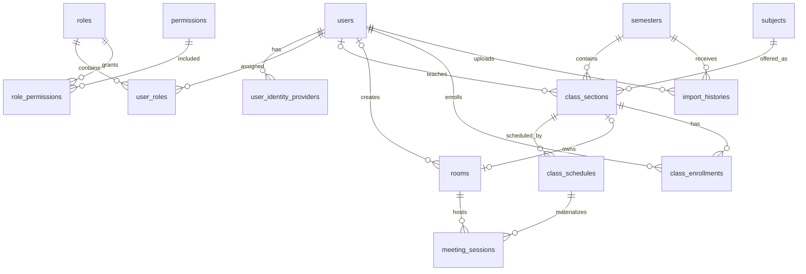

# PTIT Meeting — Database Reference

Tài liệu này mô tả mô hình dữ liệu của backend `ptit-meeting-backend`, nhằm cung cấp ngữ cảnh đầy đủ cho lập trình viên hoặc AI/ChatGPT khi phân tích, viết truy vấn SQL, phát triển API và xử lý lỗi.

## 1. Tổng quan kỹ thuật

- DBMS chính: MySQL, database mặc định `ptit_meeting`.
- Charset/collation trong script khởi tạo: `utf8mb4` / `utf8mb4_unicode_ci`.
- ORM: Spring Data JPA/Hibernate.
- Khóa chính của mọi bảng: `BIGINT AUTO_INCREMENT` tên `id`.
- Thời gian: `DATETIME`; ngày: `DATE`; giờ: `TIME`.
- Enum Java được lưu dưới dạng chuỗi (`VARCHAR`) bằng `EnumType.STRING`.
- Cấu hình hiện tại dùng `spring.jpa.hibernate.ddl-auto: update`; Liquibase bị tắt. Vì vậy schema thực tế có thể được Hibernate cập nhật và lệch nhẹ so với các script SQL.
- Nguồn schema: `src/main/resources/db/sql/init_auth_schema_and_data.sql`, `init_timetable_schema.sql` và các JPA entity.

## 2. Miền nghiệp vụ

Database có hai nhóm chính:

1. **Xác thực và phân quyền:** người dùng, nhà cung cấp danh tính, vai trò, quyền.
2. **Thời khóa biểu và phòng học trực tuyến:** học kỳ, môn học, lớp học phần, lịch học, phòng, buổi học, ghi danh và lịch sử import.

Hiện có 14 bảng:

| Nhóm | Bảng |
|---|---|
| Auth | `users`, `user_identity_providers`, `roles`, `permissions`, `user_roles`, `role_permissions` |
| Timetable | `semesters`, `subjects`, `class_sections`, `class_schedules`, `rooms`, `meeting_sessions`, `class_enrollments`, `import_histories` |

## 3. Sơ đồ quan hệ



Quan hệ quan trọng:

- Một user có nhiều role qua `user_roles`; một role có nhiều permission qua `role_permissions`.
- Một học kỳ có nhiều lớp học phần.
- Một môn học có thể xuất hiện trong nhiều lớp học phần/học kỳ.
- Một lớp học phần có nhiều lịch học định kỳ, nhưng tối đa một phòng trực tuyến.
- Một lịch online sinh nhiều buổi học cụ thể theo các tuần được đánh dấu trong Excel.
- Sinh viên tham gia nhiều lớp qua `class_enrollments`.

## 4. Authentication & Authorization

### 4.1. `users`

Lưu tài khoản hệ thống. Role không nằm trực tiếp trong bảng này mà được gán qua `user_roles`.

| Cột | Kiểu | Null | Ràng buộc/mặc định | Ý nghĩa |
|---|---|---:|---|---|
| `id` | BIGINT | No | PK, auto increment | ID user |
| `email` | VARCHAR(150) | No | UNIQUE | Email đăng nhập |
| `password_hash` | VARCHAR(255) | Yes | | BCrypt hash; có thể null với tài khoản SSO |
| `full_name` | VARCHAR(150) | No | | Họ tên |
| `code` | VARCHAR(30) | Yes | INDEX | Mã sinh viên/giảng viên/nhân sự; chưa có UNIQUE |
| `account_type` | VARCHAR(50) | No | INDEX | Loại tài khoản |
| `department` | VARCHAR(150) | Yes | | Khoa/đơn vị |
| `status` | VARCHAR(50) | No | `ACTIVE` | Trạng thái tài khoản |
| `must_change_password` | BOOLEAN | No | `TRUE` | Có bắt buộc đổi mật khẩu lần đầu không |
| `created_at` | DATETIME | No | current timestamp | Ngày tạo |
| `updated_at` | DATETIME | No | current timestamp/update | Ngày cập nhật |

Enum `account_type`: `STUDENT`, `LECTURER`, `STAFF`, `ADMIN`.

Enum `status`: `ACTIVE`, `LOCKED`, `INACTIVE`.

Lưu ý: quyền API được xác định từ `user_roles`, không phải chỉ từ `account_type`. Nên giữ hai giá trị nhất quán về nghiệp vụ.

### 4.2. `user_identity_providers`

Liên kết user với phương thức đăng nhập local hoặc Microsoft Entra ID.

| Cột | Kiểu | Null | Ràng buộc/mặc định | Ý nghĩa |
|---|---|---:|---|---|
| `id` | BIGINT | No | PK | ID liên kết |
| `user_id` | BIGINT | No | FK → `users.id`, ON DELETE CASCADE | User sở hữu |
| `provider` | VARCHAR(50) | No | mặc định `AZURE_AD` | Nhà cung cấp danh tính |
| `provider_subject_id` | VARCHAR(100) | No | UNIQUE cùng `provider` | ID user tại provider |
| `email_at_login` | VARCHAR(150) | No | | Email tại lần đăng nhập |
| `linked_at` | DATETIME | No | current timestamp | Thời điểm liên kết |
| `last_login_at` | DATETIME | Yes | | Lần đăng nhập gần nhất |

Enum `provider`: `AZURE_AD`, `LOCAL`.

Unique key: `(provider, provider_subject_id)`.

### 4.3. `roles`

| Cột | Kiểu | Null | Ràng buộc | Ý nghĩa |
|---|---|---:|---|---|
| `id` | BIGINT | No | PK | ID role |
| `code` | VARCHAR(50) | No | UNIQUE | Mã role dùng bởi Spring Security |
| `name` | VARCHAR(100) | No | | Tên hiển thị |
| `description` | VARCHAR(255) | Yes | | Mô tả |

Role chuẩn:

| ID seed | Code | Ý nghĩa |
|---:|---|---|
| 1 | `ROLE_STUDENT` | Sinh viên |
| 2 | `ROLE_LECTURER` | Giảng viên |
| 3 | `ROLE_STAFF` | Cán bộ |
| 4 | `ROLE_ADMIN` | Quản trị viên |

Không nên phụ thuộc tuyệt đối vào ID seed khi viết code; nên tra cứu theo `code`.

### 4.4. `permissions`

| Cột | Kiểu | Null | Ràng buộc | Ý nghĩa |
|---|---|---:|---|---|
| `id` | BIGINT | No | PK | ID permission |
| `code` | VARCHAR(100) | No | UNIQUE | Mã quyền |
| `name` | VARCHAR(150) | No | | Tên quyền |
| `module` | VARCHAR(50) | No | | Module sở hữu quyền |

Script hiện chưa seed danh sách permission cụ thể.

### 4.5. `user_roles`

Bảng nối many-to-many giữa user và role.

| Cột | Kiểu | Null | Ràng buộc/mặc định | Ý nghĩa |
|---|---|---:|---|---|
| `id` | BIGINT | No | PK | ID bản ghi |
| `user_id` | BIGINT | No | FK → `users.id`, CASCADE | User |
| `role_id` | BIGINT | No | FK → `roles.id`, CASCADE | Role |
| `assigned_at` | DATETIME | No | current timestamp | Thời điểm gán |

Unique key: `(user_id, role_id)`. Một user có thể có nhiều role nhưng không thể bị gán cùng role hai lần.

### 4.6. `role_permissions`

Bảng nối many-to-many giữa role và permission.

| Cột | Kiểu | Null | Ràng buộc | Ý nghĩa |
|---|---|---:|---|---|
| `id` | BIGINT | No | PK | ID bản ghi |
| `role_id` | BIGINT | No | FK → `roles.id`, CASCADE | Role |
| `permission_id` | BIGINT | No | FK → `permissions.id`, CASCADE | Permission |

Unique key: `(role_id, permission_id)`.

## 5. Timetable & Meeting

### 5.1. `semesters`

| Cột | Kiểu | Null | Ràng buộc/mặc định | Ý nghĩa |
|---|---|---:|---|---|
| `id` | BIGINT | No | PK | ID học kỳ |
| `code` | VARCHAR(50) | No | UNIQUE | Mã học kỳ, ví dụ `2026_HK1` |
| `name` | VARCHAR(100) | No | | Tên học kỳ |
| `academic_year` | VARCHAR(20) | No | | Năm học, ví dụ `2026-2027` |
| `semester_num` | TINYINT/INTEGER | No | | Số học kỳ |
| `start_date` | DATE | No | | Ngày bắt đầu; mốc tính ngày học theo tuần |
| `end_date` | DATE | No | | Ngày kết thúc |
| `is_active` | BOOLEAN | No | `FALSE` | Học kỳ đang hoạt động |
| `created_at` | DATETIME | No | current timestamp | Ngày tạo |
| `updated_at` | DATETIME | No | auto update | Ngày cập nhật |

Index: `is_active`. Import thời khóa biểu bắt buộc nhận một `semesterId` tồn tại.

### 5.2. `subjects`

| Cột | Kiểu | Null | Ràng buộc/mặc định | Ý nghĩa |
|---|---|---:|---|---|
| `id` | BIGINT | No | PK | ID môn |
| `code` | VARCHAR(30) | No | UNIQUE | Mã môn từ Excel |
| `name` | VARCHAR(150) | No | | Tên môn |
| `credit` | INT | No | `3` | Số tín chỉ |
| `department` | VARCHAR(150) | Yes | | Khoa phụ trách |
| `created_at` | DATETIME | No | current timestamp | Ngày tạo |
| `updated_at` | DATETIME | No | auto update | Ngày cập nhật |

Import thực hiện upsert theo `code`: môn đã tồn tại được dùng lại; tên/tín chỉ hiện không được cập nhật lại.

### 5.3. `class_sections`

Lớp học phần của một môn trong một học kỳ.

| Cột | Kiểu | Null | Ràng buộc/mặc định | Ý nghĩa |
|---|---|---:|---|---|
| `id` | BIGINT | No | PK | ID lớp học phần |
| `semester_id` | BIGINT | No | FK → `semesters.id`, CASCADE | Học kỳ |
| `subject_id` | BIGINT | No | FK → `subjects.id`, RESTRICT | Môn học |
| `lecturer_id` | BIGINT | Yes | FK → `users.id`, SET NULL | Giảng viên khớp được với user |
| `lecturer_name` | VARCHAR(150) | Yes | | Giá trị giảng viên gốc từ Excel |
| `cohort` | VARCHAR(20) | Yes | | Khóa học |
| `class_code` | VARCHAR(50) | No | UNIQUE cùng học kỳ | Mã lớp sinh từ mã môn/nhóm/tổ TH |
| `group_number` | VARCHAR(20) | Yes | | Nhóm môn |
| `practice_group` | VARCHAR(20) | Yes | | Tổ thực hành |
| `management_class` | VARCHAR(255) | Yes | | Lớp quản lý sinh viên |
| `status` | VARCHAR(30) | No | `ACTIVE` | Trạng thái lớp |
| `created_at` | DATETIME | No | current timestamp | Ngày tạo |
| `updated_at` | DATETIME | No | auto update | Ngày cập nhật |

Enum `status`: `ACTIVE`, `CANCELED`, `COMPLETED`.

Unique key: `(class_code, semester_id)`. `class_code` được tạo theo mẫu gần đúng: `{subjectCode}_{groupNumber}_TH{practiceGroup}`, bỏ phần không có dữ liệu.

### 5.4. `class_schedules`

Lịch học định kỳ của lớp học phần. Một lớp có thể có nhiều dòng lịch.

| Cột | Kiểu | Null | Ràng buộc/mặc định | Ý nghĩa |
|---|---|---:|---|---|
| `id` | BIGINT | No | PK | ID lịch |
| `class_section_id` | BIGINT | No | FK → `class_sections.id`, CASCADE | Lớp học phần |
| `day_of_week` | TINYINT/INTEGER | No | | Thứ học, giá trị 2–8 từ Excel |
| `start_period` | INT | No | | Tiết bắt đầu |
| `num_periods` | INT | No | | Số tiết |
| `start_time` | TIME | No | | Giờ bắt đầu quy đổi từ tiết |
| `end_time` | TIME | No | | Giờ kết thúc |
| `weeks_pattern` | VARCHAR(100) | No | | Chuỗi tuần, ví dụ `[1, 2, 4]` |
| `room_text` | VARCHAR(50) | Yes | | Phòng gốc từ Excel; `ONLINE` đánh dấu lịch online |
| `building` | VARCHAR(50) | Yes | | Tòa nhà |
| `is_online` | BOOLEAN | No | `FALSE` | Có phải lịch online |
| `created_at` | DATETIME | No | current timestamp | Ngày tạo |
| `updated_at` | DATETIME | No | auto update | Ngày cập nhật |

Hiện chưa có unique key chống lịch trùng. Import lại cùng file có thể tạo thêm `class_schedules` trùng.

### 5.5. `rooms`

Phòng học trực tuyến, thường gắn cố định với một lớp học phần.

| Cột | Kiểu | Null | Ràng buộc/mặc định | Ý nghĩa |
|---|---|---:|---|---|
| `id` | BIGINT | No | PK | ID phòng |
| `class_section_id` | BIGINT | Yes | UNIQUE, FK → `class_sections.id`, CASCADE | Tối đa một phòng/lớp |
| `created_by` | BIGINT | Yes | FK → `users.id`, SET NULL | Người tạo |
| `name` | VARCHAR(150) | No | | Tên phòng |
| `external_engine_id` | VARCHAR(100) | Yes | | ID phòng từ nền tảng ngoài |
| `passcode` | VARCHAR(20) | Yes | | Mã PIN/phòng |
| `status` | VARCHAR(30) | No | `ACTIVE` | Trạng thái |
| `created_at` | DATETIME | No | current timestamp | Ngày tạo |
| `updated_at` | DATETIME | No | auto update | Ngày cập nhật |

Enum `status`: `ACTIVE`, `LOCKED`, `CLOSED`.

Khi import dòng `ONLINE`, backend tự tạo phòng nếu lớp chưa có phòng, đặt tên theo lớp và sinh PIN 6 chữ số.

### 5.6. `meeting_sessions`

Buổi học cụ thể theo ngày, được sinh từ lịch định kỳ và tuần học.

| Cột | Kiểu | Null | Ràng buộc/mặc định | Ý nghĩa |
|---|---|---:|---|---|
| `id` | BIGINT | No | PK | ID buổi học |
| `room_id` | BIGINT | No | FK → `rooms.id`, CASCADE | Phòng online |
| `schedule_id` | BIGINT | No | FK → `class_schedules.id`, CASCADE | Lịch nguồn |
| `study_date` | DATE | No | INDEX cùng status | Ngày học |
| `scheduled_start` | DATETIME | No | | Giờ bắt đầu dự kiến |
| `scheduled_end` | DATETIME | No | | Giờ kết thúc dự kiến |
| `actual_start` | DATETIME | Yes | | Giờ bắt đầu thực tế |
| `actual_end` | DATETIME | Yes | | Giờ kết thúc thực tế |
| `status` | VARCHAR(30) | No | `SCHEDULED` | Trạng thái buổi |
| `created_at` | DATETIME | No | current timestamp | Ngày tạo |
| `updated_at` | DATETIME | No | auto update | Ngày cập nhật |

Enum `status`: `SCHEDULED`, `LIVE`, `ENDED`, `CANCELLED`.

Backend kiểm tra tồn tại theo `(schedule_id, study_date)` trước khi tạo session, nhưng schema SQL chưa khai báo unique key tương ứng.

### 5.7. `class_enrollments`

Bảng nối sinh viên với lớp học phần.

| Cột | Kiểu | Null | Ràng buộc/mặc định | Ý nghĩa |
|---|---|---:|---|---|
| `id` | BIGINT | No | PK | ID ghi danh |
| `class_section_id` | BIGINT | No | FK → `class_sections.id`, CASCADE | Lớp |
| `student_id` | BIGINT | No | FK → `users.id`, CASCADE | Sinh viên |
| `status` | VARCHAR(30) | No | `ENROLLED` | Trạng thái ghi danh |
| `enrolled_at` | DATETIME | No | current timestamp | Thời điểm ghi danh |

Enum `status`: `ENROLLED`, `DROPPED`.

Unique key: `(class_section_id, student_id)`.

Chức năng import ghi danh sinh viên mới được dự trù qua enum `STUDENT_ENROLMENT`; hiện chưa có endpoint/adapter import hoàn chỉnh.

### 5.8. `import_histories`

Theo dõi từng lần upload/import file.

| Cột | Kiểu | Null | Ràng buộc/mặc định | Ý nghĩa |
|---|---|---:|---|---|
| `id` | BIGINT | No | PK | ID lần import |
| `semester_id` | BIGINT | No | FK → `semesters.id`, CASCADE | Học kỳ đích |
| `uploaded_by` | BIGINT | No | FK → `users.id`, CASCADE | Người upload |
| `file_name` | VARCHAR(255) | No | | Tên file gốc |
| `file_url` | VARCHAR(500) | Yes | | Đường dẫn file đã lưu |
| `import_type` | VARCHAR(50) | No | | Loại import |
| `total_rows` | INT | No | `0` | Tổng dòng dữ liệu |
| `success_rows` | INT | No | `0` | Dòng thành công |
| `failed_rows` | INT | No | `0` | Dòng thất bại |
| `status` | VARCHAR(30) | No | `PROCESSING` | Trạng thái import |
| `error_log` | JSON | Yes | | Danh sách lỗi hoặc lỗi hệ thống |
| `created_at` | DATETIME | No | current timestamp | Bắt đầu import |
| `updated_at` | DATETIME | No | auto update | Cập nhật gần nhất |

Enum `import_type`: `MASTER_TIMETABLE`, `STUDENT_ENROLMENT`.

Enum `status`: `PROCESSING`, `SUCCESS`, `PARTIAL_SUCCESS`, `FAILED`.

Backend không cho hai import `PROCESSING` chạy đồng thời trên cùng học kỳ. Job `PROCESSING` cũ hơn 3 phút được xem là stale và chuyển sang `FAILED`.

## 6. Luồng import thời khóa biểu

Endpoint hiện có:

```http
POST /api/v1/admin/timetable/master/upload
Content-Type: multipart/form-data
Authorization: Bearer <JWT>

semesterId=<semesters.id>
file=<xlsx-or-xls>
```

Chỉ `ROLE_STAFF` và `ROLE_ADMIN` được truy cập `/api/v1/admin/**`.

Luồng ghi dữ liệu:

1. Kiểm tra `semesters.id` tồn tại.
2. Lưu file gốc và tạo `import_histories` ở trạng thái `PROCESSING`.
3. Dò header, cột tuần và đọc từng dòng Excel.
4. Upsert `subjects` theo `subjects.code`.
5. Upsert `class_sections` theo `(class_code, semester_id)`.
6. Luôn insert một `class_schedules` cho mỗi dòng hợp lệ.
7. Với lịch `ONLINE`, lấy/tạo `rooms`, sau đó sinh `meeting_sessions` theo từng tuần.
8. Cập nhật thống kê và lỗi JSON trong `import_histories`.

Một dòng import tối thiểu cần có mã môn và ít nhất một tuần đánh dấu `x`; `day_of_week` phải trong khoảng 2–8. Dòng lỗi bị bỏ qua, các dòng hợp lệ vẫn được commit và kết quả là `PARTIAL_SUCCESS`.

## 7. Đối chiếu file Excel thực tế với database

Phần này phân tích trực tiếp file:

```text
1606_TKB-hoc-ky-1-nam-hoc-2026-2027 (1).xlsx
```

### 7.1. Cấu trúc workbook

| Thuộc tính | Giá trị thực tế |
|---|---|
| Sheet được backend đọc | `TKB CHINH` (sheet đầu tiên) |
| Tổng số dòng vật lý | 4.482 |
| Tổng số cột | 45, từ A đến AS |
| Dòng tiêu đề backend nhận diện | Dòng 7 |
| Dòng dữ liệu đầu tiên | Dòng 12 |
| Dòng dữ liệu cuối | Dòng 4.482 |
| Tổng dòng dữ liệu được xét | 4.471 |
| Cột tuần được nhận diện | R–AH, tuần 1–17 |
| Dòng hợp lệ | 4.469 |
| Dòng lỗi | 2: dòng 1.557 và 4.233 |

Workbook có tiêu đề nhiều tầng:

- Dòng 5 chứa số tuần 1–17.
- Dòng 6 chứa tuần thứ tự theo năm, từ 23–39.
- Dòng 7 chứa tên cột chính và các tháng.
- Dòng 8–9 chứa ngày bắt đầu/kết thúc của từng tuần.
- Dòng 10 lặp lại số tuần 1–17.
- Dòng 11 chứa công thức Excel trả về `#N/A`; backend không sử dụng dòng này.
- Dữ liệu thật bắt đầu ở dòng 12.

Backend tìm dãy số `1, 2, 3, ...` gần dòng header và dùng vị trí đó làm cột tuần. Với file này, dãy đầu tiên được tìm thấy ở dòng 5, cột R–AH, nên hệ thống nhận đúng 17 tuần.

### 7.2. Bản đồ Excel → DTO → database

| Cột Excel | Nội dung | Trường trung gian | Nơi lưu trong DB | Cách xử lý |
|---|---|---|---|---|
| A — `TT` | Số thứ tự | Không đọc | Không lưu | Chỉ để hiển thị trong Excel |
| B — `Mã môn học` | Mã môn | `subjectCode` | `subjects.code` | Bắt buộc; dùng để tìm hoặc tạo môn |
| C — `Tên môn học/ học phần` | Tên môn | `subjectName` | `subjects.name` | Chỉ được dùng khi tạo môn mới |
| D — `Khóa` | Khóa tuyển sinh | `cohort` | `class_sections.cohort` | Ví dụ `2023`, `2024`, `2025` |
| E — `Hệ` | Hệ đào tạo | Không đọc | Không lưu | Dữ liệu hiện bị bỏ qua |
| F — `Ngành` | Mã ngành | Không đọc | Không lưu | Dữ liệu hiện bị bỏ qua |
| G — `Nhóm` | Nhóm học phần | `groupNumber` | `class_sections.group_number` | Tham gia tạo `class_code` |
| H — `Tổ hợp` | Tổ hợp/nhóm kết hợp | Không đọc | Không lưu | Dữ liệu hiện bị bỏ qua |
| I — `Tổ TH` | Tổ thực hành | `practiceGroup` | `class_sections.practice_group` | Tham gia tạo `class_code` |
| J — `Thứ` | Thứ trong tuần | `dayOfWeek` | `class_schedules.day_of_week` | Chỉ nhận 2–8 |
| K — `Tiết BĐ` | Tiết bắt đầu | `startPeriod` | `class_schedules.start_period` | Đồng thời được quy đổi ra `start_time` |
| L — `Số tiết` | Thời lượng theo tiết | `numPeriods` | `class_schedules.num_periods` | Dùng tính `end_time` |
| M — `Giảng viên giảng dạy` | Tên/mã GV | `lecturerName` | `class_sections.lecturer_name`; có thể map `lecturer_id` | Backend thử tìm user bằng email hoặc code; với dữ liệu là họ tên, đa số sẽ không map được ID |
| N — `Khoa` | Khoa phụ trách | Không đọc | Không lưu | Không phải `subjects.department` trong code hiện tại |
| O — `Bộ môn` | Bộ môn | Không đọc | Không lưu | Dữ liệu hiện bị bỏ qua |
| P — `Ghi chú` | Ghi chú điều chỉnh | Không đọc | Không lưu | File có 4 dòng mang giá trị `điều chỉnh` |
| Q — `Tháng` | Nhãn nhóm cột tuần | Không đọc | Không lưu | Chỉ phục vụ trình bày |
| R–AH — tuần 1–17 | Tuần có học | `activeWeeks` | `class_schedules.weeks_pattern` | Ô có `x` (không phân biệt hoa/thường) được đưa vào tập tuần |
| AI — `Phòng` | Phòng học | `roomText` | `class_schedules.room_text` | Nếu bằng `ONLINE` thì `is_online = true` và tạo phòng online |
| AJ — `Nhà` | Tòa nhà | `building` | `class_schedules.building` | Có thể null |
| AK — `Mã lớp` | Danh sách lớp quản lý | `managementClass` | `class_sections.management_class` | Có thể chứa nhiều mã cách nhau bằng dấu phẩy; tên header hơi dễ gây nhầm với `class_code` |
| AL — `Số TC` | Số tín chỉ | `credit` | `subjects.credit` | Nếu trống khi tạo môn mới thì mặc định 3 |
| AM — `Phân bổ CT` / `TS tiết` | Tổng số tiết CT | Không đọc | Không lưu | Dữ liệu hiện bị bỏ qua |
| AN — `LT` | Tiết lý thuyết | Không đọc | Không lưu | Dữ liệu hiện bị bỏ qua |
| AO — `TL/BT` | Thảo luận/bài tập | Không đọc | Không lưu | Dữ liệu hiện bị bỏ qua |
| AP — `BTL` | Bài tập lớn | Không đọc | Không lưu | Dữ liệu hiện bị bỏ qua |
| AQ — `TH/TN` | Thực hành/thí nghiệm | Không đọc | Không lưu | Dữ liệu hiện bị bỏ qua |
| AR — `Tự học` | Số tiết tự học | Không đọc | Không lưu | Dữ liệu hiện bị bỏ qua |
| AS — `LMS` | Phân bổ LMS | Không đọc | Không lưu | Dữ liệu hiện bị bỏ qua |

Như vậy, backend hiện chỉ map 13 nhóm cột lõi cùng 17 cột tuần. Các thông tin `Hệ`, `Ngành`, `Tổ hợp`, `Khoa`, `Bộ môn`, `Ghi chú` và phân bổ chương trình chưa có cột đích trong database hoặc chưa được code import sử dụng.

### 7.3. Các giá trị được backend tự sinh

Một số trường trong DB không được lấy trực tiếp từ Excel:

| Trường DB | Nguồn/cách tạo |
|---|---|
| `class_sections.semester_id` | Lấy từ tham số `semesterId` của request, trong lần import này là `1` |
| `class_sections.subject_id` | ID của môn tìm/tạo từ `Mã môn học` |
| `class_sections.class_code` | Ghép `Mã môn học`, `Nhóm`, và nếu có thì `_TH` + `Tổ TH` |
| `class_sections.status` | Mặc định `ACTIVE` |
| `class_schedules.class_section_id` | ID lớp học phần tìm/tạo ở bước trước |
| `class_schedules.start_time` | Quy đổi từ tiết bắt đầu theo bảng giờ hard-code trong backend |
| `class_schedules.end_time` | `start_time + num_periods × 50 phút` |
| `class_schedules.is_online` | `true` khi cột Phòng bằng `ONLINE`, ngược lại `false` |
| `rooms.name` | `Phòng trực tuyến - {class_code}` |
| `rooms.passcode` | Số ngẫu nhiên 6 chữ số |
| `rooms.status` | Mặc định `ACTIVE` |
| `meeting_sessions.study_date` | Tính từ `semester.start_date`, số tuần và `day_of_week` |
| `meeting_sessions.scheduled_start/end` | Ghép `study_date` với giờ bắt đầu/kết thúc lịch |
| `meeting_sessions.status` | Mặc định `SCHEDULED` |
| `import_histories.uploaded_by` | ID user trong JWT thực hiện upload |
| `import_histories.file_url` | Đường dẫn file sau khi lưu vào `uploads/timetables` |
| Các cột `created_at`, `updated_at` | Thời điểm backend/DB tạo hoặc cập nhật bản ghi |

Bảng quy đổi tiết bắt đầu hiện tại:

| Tiết | Giờ bắt đầu | Tiết | Giờ bắt đầu |
|---:|---|---:|---|
| 1 | 07:00 | 7 | 12:30 |
| 2 | 07:50 | 8 | 13:20 |
| 3 | 08:50 | 9 | 14:20 |
| 4 | 09:40 | 10 | 15:10 |
| 5 | 10:30 | 11 | 16:00 |
| 6 | 11:20 | 12 | 16:50 |

### 7.4. Ví dụ đối chiếu một dòng cụ thể

Dòng Excel 12 có dữ liệu chính:

```text
Mã môn: AI1306
Tên môn: Khoa học dữ liệu cơ bản
Khóa: 2025
Nhóm: 01
Tổ TH: trống
Thứ: 3
Tiết bắt đầu: 8
Số tiết: 2
Giảng viên: Trần Tiến Công
Tuần có x: 1–13
Phòng: G02
Nhà: A2
Mã lớp quản lý: D25CQTN01-B,D25CQTN02-B,D25CQTN03-B
Số tín chỉ: 3
```

Các bản ghi logic được tạo/tái sử dụng:

```text
subjects
  code = AI1306
  name = Khoa học dữ liệu cơ bản
  credit = 3

class_sections
  semester_id = 1
  subject_id = ID của AI1306
  lecturer_name = Trần Tiến Công
  cohort = 2025
  class_code = AI1306_01
  group_number = 01
  practice_group = null
  management_class = D25CQTN01-B,D25CQTN02-B,D25CQTN03-B
  status = ACTIVE

class_schedules
  class_section_id = ID của AI1306_01
  day_of_week = 3
  start_period = 8
  num_periods = 2
  start_time = 13:20
  end_time = 15:00
  weeks_pattern = [1, 2, 3, ..., 13]
  room_text = G02
  building = A2
  is_online = false
```

Dòng này không tạo `rooms` hoặc `meeting_sessions`, vì `G02` không phải từ khóa `ONLINE`.

### 7.5. Kết quả đối chiếu lần import đã thực hiện

Response của lần import có `importId = 1` cho biết:

| Chỉ số | Giá trị | Cách hiểu đúng |
|---|---:|---|
| Tổng dòng | 4.471 | Toàn bộ dòng Excel 12–4.482 |
| Thành công | 4.469 | Số dòng đã tạo `class_schedules` |
| Thất bại | 2 | Hai dòng này không được đưa sang bước ghi DB; subject/class tương ứng vẫn có thể tồn tại do các dòng hợp lệ khác |
| Môn đã xử lý | 336 | Số **mã môn khác nhau** trong các dòng thành công, không nhất thiết là 336 row mới được insert |
| Lớp học phần đã xử lý | 2.334 | Số `class_code` khác nhau, không nhất thiết tất cả đều là row mới nếu DB đã có dữ liệu |
| Lịch đã lưu | 4.469 | Mỗi dòng hợp lệ tạo một row `class_schedules` |
| Phòng online đã tạo | 4 | Có đúng 4 dòng/lớp dùng `Online` trong file |
| Buổi online đã sinh | 8 | Bốn lịch online, mỗi lịch có hai tuần được đánh dấu `x` |
| Trạng thái | `PARTIAL_SUCCESS` | Request chạy xong nhưng có hai dòng lỗi |

Trong file có 336 mã môn nhưng chỉ 312 tên môn khác nhau. Điều này không mâu thuẫn: nhiều mã môn có thể dùng cùng một tên học phần, hoặc tên được lặp/biến thể theo chương trình.

Bốn dòng online là:

| Dòng Excel | Mã môn | Nhóm | Thứ | Tuần hoạt động |
|---:|---|---|---:|---|
| 977 | `BSA1349` | `01` | 8 | 1, 2 |
| 980 | `BSA1349` | `02` | 8 | 3, 4 |
| 1.086 | `BSA1468` | `01` | 8 | 9, 10 |
| 1.089 | `BSA1468` | `02` | 8 | 11, 12 |

Hai dòng lỗi:

| Dòng | Môn | Nhóm | Thứ | Phòng | Nguyên nhân |
|---:|---|---|---:|---|---|
| 1.557 | `ELE1347` — Thực hành cơ sở (ĐK&TĐH) | `04` | 6 | `HT` | Không có tuần nào trong R–AH được đánh dấu `x` |
| 4.233 | `SKD1111` — Kỹ năng đổi mới sáng tạo | `06` | 3 | trống | Không có tuần nào trong R–AH được đánh dấu `x` |

Hai dòng này bị loại ở bước validate trước khi ghi dữ liệu lịch. Muốn import chúng phải đánh dấu `x` ở ít nhất một trong 17 cột tuần.

### 7.6. Ý nghĩa nghiệp vụ của từng nhóm bảng sau import

Để đọc DB dễ hơn, có thể hình dung dữ liệu theo chuỗi:

```text
semesters (học kỳ được chọn)
  └─ class_sections (các lớp học phần trong học kỳ)
       ├─ subjects (môn mà lớp đang giảng dạy)
       ├─ lecturer_id → users (giảng viên, nếu map được)
       ├─ class_schedules (các ca học: thứ, tiết, tuần, phòng)
       │    └─ meeting_sessions (từng ngày học online cụ thể)
       ├─ rooms (phòng online cố định của lớp)
       └─ class_enrollments → users (các sinh viên của lớp)

import_histories ghi lại ai đã đưa file nào vào học kỳ nào và kết quả ra sao.
```

Phân biệt ba khái niệm thường dễ nhầm:

- `subjects`: danh mục môn, ví dụ **AI1306 — Khoa học dữ liệu cơ bản**.
- `class_sections`: một nhóm/tổ cụ thể của môn trong một học kỳ, ví dụ **AI1306_01**.
- `class_schedules`: một ca học của lớp đó, ví dụ **thứ 3, tiết 8–9, các tuần 1–13, phòng G02**.

Một `subject` có nhiều `class_sections`; một `class_section` có thể có nhiều `class_schedules`. Vì vậy 336 môn tạo thành 2.334 lớp học phần và 4.469 lịch học là hợp lý.

### 7.7. Những dữ liệu chưa được import và ảnh hưởng

Các cột bị bỏ qua có thể quan trọng nếu sau này cần lọc/báo cáo:

- Không lưu `Hệ` và `Ngành`: không thể lọc lớp theo hệ đào tạo hoặc ngành chỉ bằng DB hiện tại.
- Không lưu `Khoa` và `Bộ môn`: `subjects.department` hiện vẫn null khi import mặc dù Excel có dữ liệu này.
- Không lưu `Tổ hợp`: có thể làm mất khả năng phân biệt một số tổ hợp lớp.
- Không lưu `Ghi chú`: thông tin điều chỉnh lịch không được giữ lại.
- Không lưu phân bổ `LT`, `TL/BT`, `BTL`, `TH/TN`, `Tự học`, `LMS`: không thể tái tạo đầy đủ phân bổ chương trình từ DB.
- `Mã lớp` được lưu nguyên chuỗi vào `management_class`, chưa tách thành bảng/lớp riêng.
- Giảng viên trong file là họ tên, nhưng backend tìm `users` theo email hoặc code; vì vậy `lecturer_name` có dữ liệu nhưng `lecturer_id` thường null.
- Các phòng vật lý chỉ được lưu dạng text trong `class_schedules`; bảng `rooms` hiện được dùng cho phòng online, không phải danh mục phòng vật lý.

### 7.8. Cảnh báo tính toàn vẹn khi import lại

- `subjects` và `class_sections` được tìm lại theo khóa nghiệp vụ nên thường không nhân đôi.
- `class_schedules` luôn được insert, không kiểm tra lịch tương đương đã tồn tại. Import lại toàn file có thể tạo thêm 4.469 lịch trùng.
- Vì mỗi schedule mới có ID mới, các `meeting_sessions` online cũng có thể được sinh lại theo schedule mới.
- Chỉ nên import lại sau khi có cơ chế idempotent hoặc đã xóa đúng dữ liệu của lần import trước trong phạm vi học kỳ.
- Số `subjectsProcessed`/`classSectionsProcessed` trong response là số đối tượng khác nhau được xử lý trong request, không phải số row SQL thực sự vừa insert.

## 8. Quy tắc xóa theo khóa ngoại

| Xóa bản ghi | Hệ quả |
|---|---|
| `users` | Xóa identity provider, user-role, enrollment và import history của user; `class_sections.lecturer_id` và `rooms.created_by` chuyển null |
| `roles` | Xóa các dòng `user_roles` và `role_permissions` liên quan |
| `permissions` | Xóa các dòng `role_permissions` liên quan |
| `semesters` | Xóa class section và import history; từ class section tiếp tục cascade lịch, phòng, session, enrollment |
| `subjects` | Bị chặn nếu còn class section tham chiếu (`RESTRICT`) |
| `class_sections` | Xóa lịch, phòng và enrollment; phòng/lịch tiếp tục xóa session |
| `class_schedules` | Xóa meeting session liên quan |
| `rooms` | Xóa meeting session liên quan |

Thao tác xóa học kỳ hoặc user có thể xóa lượng lớn dữ liệu và cần được kiểm tra trước.

## 9. Truy vấn ngữ cảnh thường dùng

### User và role

```sql
SELECT u.id, u.email, u.code, u.account_type, u.status, r.code AS role_code
FROM users u
LEFT JOIN user_roles ur ON ur.user_id = u.id
LEFT JOIN roles r ON r.id = ur.role_id
WHERE u.email = ?;
```

### Lớp học phần đầy đủ

```sql
SELECT cs.id, cs.class_code, s.code AS subject_code, s.name AS subject_name,
       se.code AS semester_code, cs.lecturer_name, cs.status
FROM class_sections cs
JOIN subjects s ON s.id = cs.subject_id
JOIN semesters se ON se.id = cs.semester_id
WHERE se.id = ?;
```

### Lịch và các buổi online

```sql
SELECT cs.class_code, sch.day_of_week, sch.start_time, sch.end_time,
       sch.weeks_pattern, r.name AS room_name, r.passcode,
       ms.study_date, ms.scheduled_start, ms.scheduled_end, ms.status
FROM class_schedules sch
JOIN class_sections cs ON cs.id = sch.class_section_id
LEFT JOIN rooms r ON r.class_section_id = cs.id
LEFT JOIN meeting_sessions ms ON ms.schedule_id = sch.id
WHERE cs.id = ?
ORDER BY ms.study_date, ms.scheduled_start;
```

### Kết quả import

```sql
SELECT id, semester_id, uploaded_by, file_name, import_type,
       total_rows, success_rows, failed_rows, status, error_log,
       created_at, updated_at
FROM import_histories
ORDER BY created_at DESC;
```

## 10. Các điểm cần lưu ý khi yêu cầu AI sửa hệ thống

- Không coi `users.account_type` là role. Role thực tế đến từ `users → user_roles → roles`.
- Các entity chủ yếu lưu ID dạng `Long`, không khai báo quan hệ JPA `@ManyToOne`; join phải dựa trên các cột `*_id`.
- Import master timetable hiện không idempotent ở `class_schedules`; import lại có thể tạo lịch trùng.
- `weeks_pattern` là chuỗi biểu diễn Java Set, không phải JSON hay bảng chuẩn hóa.
- `lecturer_name` từ Excel chỉ map sang `lecturer_id` nếu khớp email hoặc code user.
- Chỉ các dòng `room_text = ONLINE` mới tạo `rooms` và `meeting_sessions` tự động.
- `STUDENT_ENROLMENT` tồn tại trong enum/schema nhưng chức năng import tương ứng chưa hoàn thiện.
- Script SQL có đầy đủ foreign key/index; annotation entity không biểu diễn hết các constraint đó.
- Khi cần schema tuyệt đối chính xác của một database đang chạy, hãy bổ sung kết quả `SHOW CREATE TABLE <table>` vì Hibernate `ddl-auto: update` có thể làm schema runtime khác tài liệu.

## 11. Prompt gợi ý để dùng tài liệu với ChatGPT

```text
Đây là tài liệu database của hệ thống PTIT Meeting. Hãy dùng nó làm nguồn sự thật về tên bảng, cột, quan hệ và enum. Không tự tạo thêm bảng/cột không tồn tại. Nếu yêu cầu có thể gây trùng dữ liệu hoặc vi phạm khóa ngoại, hãy cảnh báo trước. [Dán nội dung DATABASE.md hoặc đính kèm file tại đây]
```
