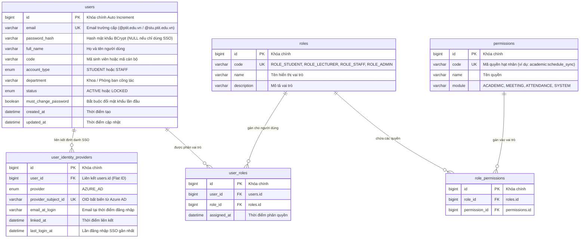
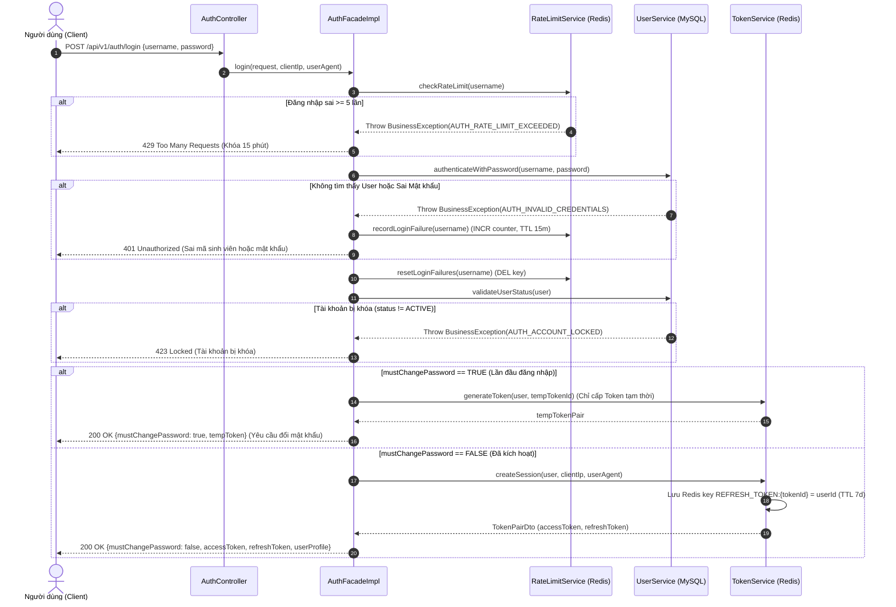
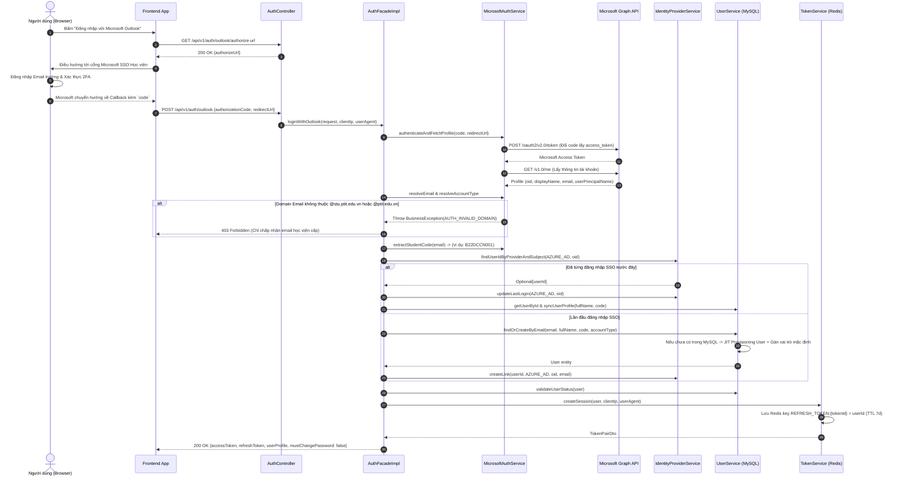
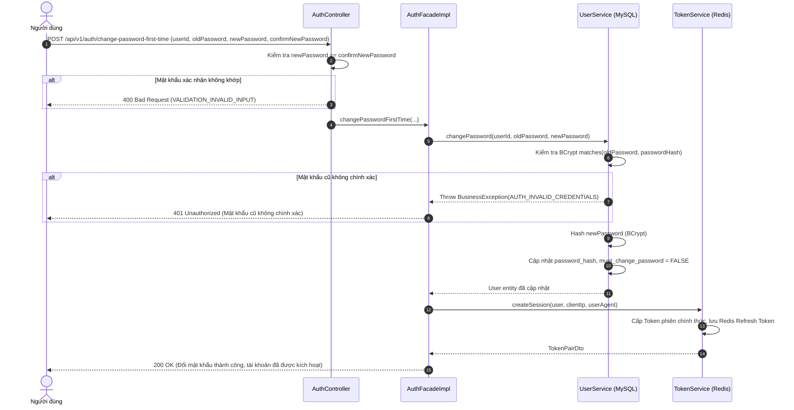
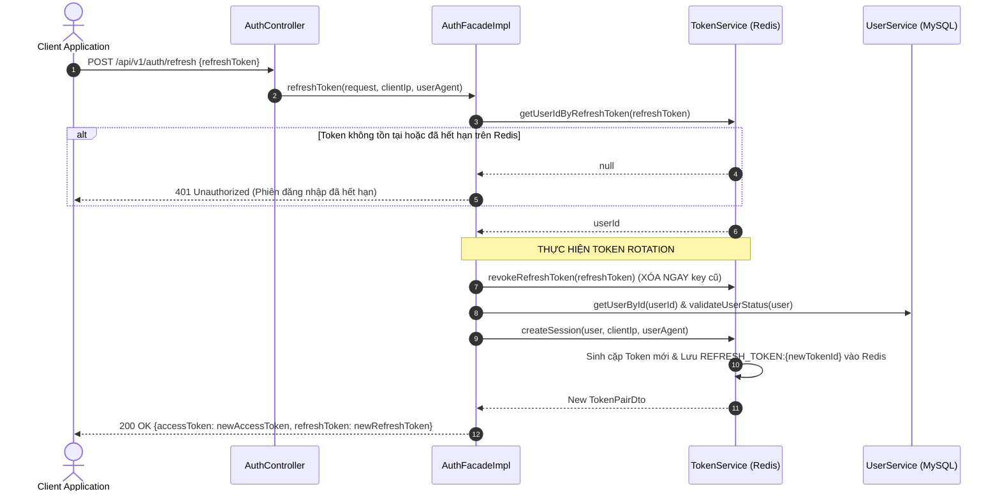
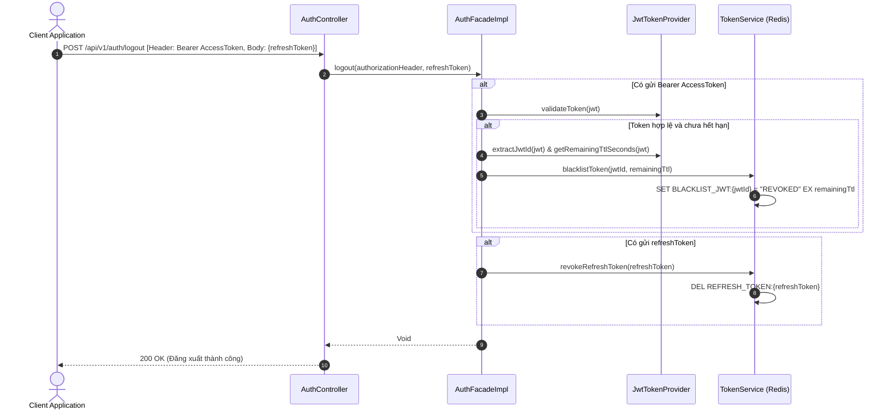
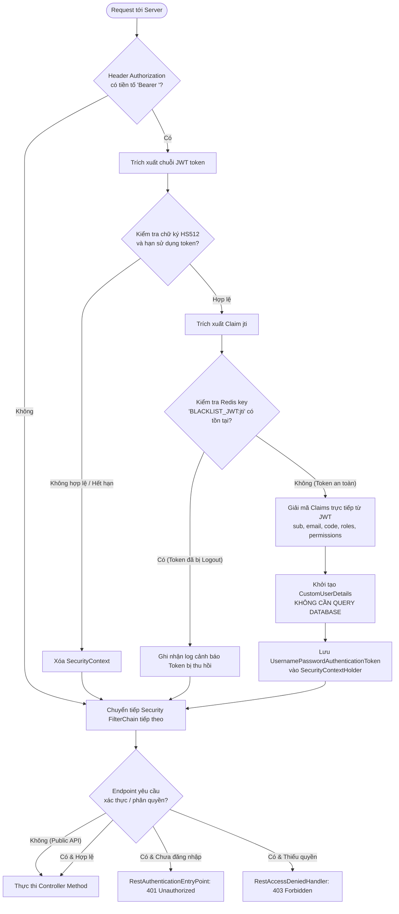

# TÀI LIỆU ĐẶC TẢ TÍNH NĂNG XÁC THỰC & PHÂN QUYỀN (AUTHENTICATION & RBAC SPECIFICATION)

**Dự án:** PTIT Meeting — Phòng học số và Hội họp trực tuyến  
**Phân hệ:** Xác thực & Phân quyền (Authentication & Authorization)  
**Phiên bản:** 1.0  
**Ngôn ngữ / Framework:** Java 17, Spring Boot 3.x, Spring Security 6.x  
**Lưu trữ:** MySQL 8.x (Flat ID References) & Redis 7.x  

---

## MỤC LỤC
1. [Mục tiêu của phân hệ Xác thực](#1-mục-tiêu-của-phân-hệ-xác-thực)
2. [Cách làm & Kiến trúc thiết kế (Approach & Architecture)](#2-cách-làm--kiến-trúc-thiết-kế)
3. [Cơ sở dữ liệu & Caching liên quan (Database & Redis Store)](#3-cơ-sở-dữ-liệu--caching-liên-quan)
4. [Diagram luồng nghiệp vụ (Business Flow Diagrams)](#4-diagram-luồng-nghiệp-vụ)
5. [Chi tiết Input & Output của các API (API Specifications)](#5-chi-tiết-input--output-của-các-api)
6. [Xử lý ngoại lệ & Danh mục mã lỗi (Exception Handling & Error Catalog)](#6-xử-lý-ngoại-lệ--danh-mục-mã-lỗi)

---

## 1. MỤC TIÊU CỦA PHÂN HỆ XÁC THỰC

### 1.1. Bối cảnh & Yêu cầu thực tế tại Học viện PTIT
Hệ thống **PTIT Meeting** phục vụ công tác giảng dạy trực tuyến, tổ chức hội nghị và quản lý điểm danh cho toàn bộ Cán bộ, Giảng viên và Sinh viên Học viện Công nghệ Bưu chính Viễn thông. Do đó, phân hệ Xác thực & Phân quyền được thiết kế để giải quyết các bài toán then chốt sau:

- **Không đăng ký tự do (No Self-Registration):** Hệ thống không mở tính năng đăng ký tài khoản tự do trên giao diện. Toàn bộ tài khoản Sinh viên và Giảng viên được đồng bộ trước từ dữ liệu đào tạo (Phòng Giáo vụ tải lên tệp Excel Danh sách lớp / Thời khóa biểu).
- **Chiến lược đăng nhập kép (Dual Login Strategy):**
  1. **Đăng nhập một chạm Microsoft Outlook SSO (Entra ID):** Phương thức chủ đạo dành cho 90%+ người dùng sử dụng email chính thức do học viện cấp (`@stu.ptit.edu.vn` cho sinh viên, `@ptit.edu.vn` cho giảng viên/cán bộ). Hỗ trợ xác thực bảo mật 2FA, không cần nhớ mật khẩu ứng dụng.
  2. **Đăng nhập truyền thống (Local Authentication):** Đăng nhập bằng Mã sinh viên (`code`) / Mã cán bộ hoặc Email kết hợp với Mật khẩu cấp sẵn. Đóng vai trò làm phương án dự phòng (fail-safe) khi người dùng gặp sự cố với tài khoản Microsoft (mất thiết bị 2FA, chưa cài Outlook,...).
- **Hợp nhất định danh duy nhất (Unified Identity):** Dù người dùng đăng nhập bằng SSO Outlook hay Local Auth, cả hai luồng xác thực đều trỏ về **duy nhất một bản ghi hồ sơ** (`users.id`). Không bao giờ phát sinh trường hợp một người có hai tài khoản trùng lặp dữ liệu trên hệ thống.
- **Fail-safe & Kích hoạt tài khoản an toàn:**
  - Sinh viên quên mật khẩu Local hoặc chưa đổi mật khẩu mặc định vẫn đăng nhập bình thường qua SSO Microsoft để không bị gián đoạn buổi học.
  - Khi đăng nhập Local lần đầu bằng mật khẩu mặc định do nhà trường cấp, hệ thống trả cờ `mustChangePassword = true`, chỉ cấp token tạm thời và bắt buộc người dùng phải đổi mật khẩu mới kích hoạt hoàn toàn tài khoản.
- **Bảo mật cao cấp & Tối ưu hiệu năng:**
  - **Stateless Authentication:** Sử dụng JSON Web Token (HS512) chứa sẵn danh sách Roles và Permissions. Bộ lọc bảo mật (`JwtAuthenticationFilter`) trích xuất trực tiếp thông tin quyền từ token claims để khởi tạo `SecurityContext` mà **không cần truy vấn Database MySQL ở mỗi request (0 query DB)**.
  - **Quản lý phiên tập trung trên Redis:** Cơ chế **Token Rotation** khi refresh và **Redis Blacklist** khi logout giúp thu hồi quyền truy cập ngay lập tức dù đang sử dụng kiến trúc Stateless.
  - **Chống tấn công Brute-force:** Tích hợp bộ đếm đăng nhập sai trên Redis; tự động khóa đăng nhập 15 phút nếu nhập sai mật khẩu liên tiếp quá 5 lần.

---

## 2. CÁCH LÀM & KIẾN TRÚC THIẾT KẾ

### 2.1. Kiến trúc phân tầng (Clean / Facade Architecture)
Mã nguồn được tổ chức theo kiến trúc phân tách rõ ràng trách nhiệm:

```
src/main/java/org/ptit/meeting/
├── controller/                 # HTTP Inbound Adapter: tiếp nhận request, validate DTO, trích xuất IP/User-Agent
│   └── AuthController.java
├── facade/                     # Orchestration Layer: điều phối quy trình xác thực giữa các domain service
│   ├── AuthFacade.java
│   └── impl/AuthFacadeImpl.java
├── service/                    # Domain Services (Single Responsibility)
│   ├── UserService.java & UserServiceImpl.java               # Xử lý thông tin user, mật khẩu, roles
│   ├── TokenService.java & TokenServiceImpl.java             # Quản lý vòng đời token, session, blacklist
│   ├── MicrosoftAuthService.java & MicrosoftAuthServiceImpl  # Xử lý OAuth code, resolve email, parse mã SV
│   ├── IdentityProviderService.java & IdentityProviderImpl   # Quản lý liên kết SSO Azure AD
│   ├── RateLimitService.java & RateLimitServiceImpl.java     # Kiểm soát tần suất đăng nhập chống brute-force
│   └── MessageService.java & MessageServiceImpl.java         # Đa ngôn ngữ hóa (i18n) thông điệp
├── client/                     # Outbound REST Client
│   └── MicrosoftGraphClient.java                             # Giao tiếp Microsoft Graph API
├── security/                   # Spring Security 6 Integration
│   ├── SecurityConfig.java                                   # Cấu hình chuỗi lọc FilterChain, CORS, Public APIs
│   ├── JwtTokenProvider.java                                 # Ký token HS512, parse claims, tính TTL
│   ├── JwtAuthenticationFilter.java                          # Filter chặn mỗi request, check Blacklist, nạp Context
│   ├── CustomUserDetails.java                                # Adapter triển khai UserDetails của Spring Security
│   ├── RestAuthenticationEntryPoint.java                     # Bắt lỗi 401 trả JSON chuẩn ResponseGeneral
│   └── RestAccessDeniedHandler.java                          # Bắt lỗi 403 trả JSON chuẩn ResponseGeneral
├── entity/                     # MySQL JPA Entities (Tuân thủ Flat ID References)
├── repository/                 # Spring Data Repositories
└── exception/                  # Global Exception Handling
    ├── ErrorCode.java                                        # Enum tập trung tất cả mã lỗi hệ thống
    ├── BaseException.java & BusinessException.java
    └── GlobalExceptionHandler.java                           # Bắt mọi ngoại lệ và đóng gói ResponseGeneral
```

### 2.2. Các cơ chế kỹ thuật cốt lõi

#### A. Cơ chế Stateless JWT + 0 Query Database khi xác thực
- **Cấu trúc Access Token:** Được ký bằng thuật toán bảo mật `HMAC-SHA512` với secret-key 512-bit.
- **Payload Claims bao gồm:** `sub` (User ID), `email`, `code` (Mã SV), `accountType`, `roles` (List tên vai trò), `permissions` (List tên quyền hạt nhân), `mustChangePassword`, `jti` (Token UUID duy nhất).
- **Xác thực tại `JwtAuthenticationFilter`:**
  1. Lấy Bearer Token từ header `Authorization`.
  2. Kiểm tra chữ ký và tính hợp lệ thời gian.
  3. Lấy `jwtId` (`jti`) và kiểm tra trên Redis: nếu key `BLACKLIST_JWT:{jwtId}` tồn tại thì chặn ngay lập tức.
  4. Trích xuất claims và khởi tạo `CustomUserDetails`, gán vào `SecurityContextHolder`.
  5. Toàn bộ quá trình diễn ra hoàn toàn trên bộ nhớ và Redis, **không truy vấn MySQL**.

#### B. Cơ chế Token Rotation & Quản lý Session trên Redis
- **Refresh Token:** Mỗi phiên đăng nhập được cấp một Refresh Token ngẫu nhiên (UUID v4).
- **Lưu trữ Redis:** Key `REFRESH_TOKEN:{tokenId}` trỏ tới giá trị `userId`, TTL là 7 ngày (`604800` giây).
- **Token Rotation:** Khi người dùng gọi endpoint `/api/v1/auth/refresh`:
  1. Kiểm tra sự tồn tại của Refresh Token trên Redis.
  2. **Thu hồi (xóa) ngay lập tức** Refresh Token vừa gửi lên.
  3. Cấp phát **cặp token mới** (New Access Token + New Refresh Token) và lưu Refresh Token mới vào Redis.
  4. Ngăn chặn triệt để tấn công Replay Attack (nếu Refresh Token bị rò rỉ, kẻ tấn công chỉ có thể dùng tối đa 1 lần trước khi bị phát hiện vô hiệu hóa).

#### C. Cơ chế Đăng xuất an toàn (Safe Logout với Redis Blacklist)
- Khi người dùng đăng xuất qua `/api/v1/auth/logout`:
  1. Hệ thống xóa key `REFRESH_TOKEN:{tokenId}` trên Redis.
  2. Trích xuất `jwtId` (`jti`) từ Access Token đang dùng.
  3. Tính thời gian sống còn lại (`remainingTtlSeconds`) của Access Token.
  4. Lưu vào Redis: Key `BLACKLIST_JWT:{jwtId}` = `"REVOKED"`, thời gian tồn tại đúng bằng `remainingTtlSeconds`.
  5. Ngay lập tức, Access Token này sẽ bị `JwtAuthenticationFilter` từ chối nếu có bất kỳ request nào gửi tới sau đó.

#### D. Cơ chế Chống tấn công Brute-force (Rate Limiting)
- Sử dụng key Redis: `LOGIN_FAIL:{username}` (với `username` là Mã sinh viên hoặc Email đăng nhập).
- Mỗi lần người dùng nhập sai mật khẩu, Redis tăng biến đếm (`INCR`). Ở lần đầu tiên ghi nhận sai, thiết lập TTL là **15 phút (900 giây)**.
- Khi gửi request đăng nhập, hệ thống kiểm tra nếu giá trị counter $\ge 5$, hệ thống ném ngoại lệ `AUTH_RATE_LIMIT_EXCEEDED` (HTTP 429) và từ chối xử lý cho đến khi hết 15 phút.
- Khi người dùng đăng nhập thành công, key `LOGIN_FAIL:{username}` được xóa ngay lập tức.

#### E. Cơ chế JIT Provisioning & Auto-link tài khoản SSO Microsoft
- Khi sinh viên/giảng viên đăng nhập qua Outlook lần đầu tiên:
  1. Đổi Authorization Code lấy Access Token từ Microsoft Graph API (`https://graph.microsoft.com/v1.0/me`).
  2. Lấy `oid` (Object ID bất biến trên Azure AD) và `email` / `userPrincipalName`.
  3. Kiểm tra domain: Chỉ chấp nhận `@stu.ptit.edu.vn` (sinh viên) hoặc `@ptit.edu.vn` (cán bộ).
  4. Tự động tách Mã sinh viên từ email (ví dụ: `nguyenvana.b22dccn001@stu.ptit.edu.vn` $\rightarrow$ Mã SV: `B22DCCN001`).
  5. Tra cứu trong `user_identity_providers`:
     - Nếu đã liên kết: Cập nhật `last_login_at`, đồng bộ tên hiển thị và mã SV mới nhất.
     - Nếu chưa liên kết: Tìm kiếm trong `users` theo email. Nếu đã có sẵn bản ghi (do phòng Đào tạo import trước), tiến hành liên kết (`createLink`). Nếu chưa có, kích hoạt cơ chế **JIT Provisioning** tự động tạo tài khoản `users`, gán vai trò mặc định (`ROLE_STUDENT` hoặc `ROLE_LECTURER`) và tạo bản ghi liên kết IDP.

---

## 3. CƠ SỞ DỮ LIỆU & CACHING LIÊN QUAN

### 3.1. Sơ đồ thực thể quan hệ nhóm Xác thực (ERD)



### 3.2. Cấu trúc bảng MySQL chi tiết

#### 1. Bảng `users` (Quản lý hồ sơ định danh cốt lõi)
| Tên cột | Kiểu dữ liệu | Nullable | Ràng buộc / Mặc định | Ý nghĩa nghiệp vụ |
| :--- | :--- | :---: | :--- | :--- |
| `id` | `BIGINT` | NO | PK, Auto Increment | Mã định danh nội bộ duy nhất của người dùng |
| `email` | `VARCHAR(150)` | NO | UNIQUE | Email định danh trường cấp |
| `password_hash`| `VARCHAR(255)` | YES | NULL | Mật khẩu mã hóa BCrypt (NULL nếu tạo qua SSO) |
| `full_name` | `VARCHAR(150)` | NO | | Họ và tên hiển thị |
| `code` | `VARCHAR(30)` | YES | NULL, INDEX | Mã sinh viên (`B22DCCN001`) hoặc mã cán bộ |
| `account_type` | `VARCHAR(50)` | NO | INDEX | `STUDENT` hoặc `STAFF` |
| `department` | `VARCHAR(150)` | YES | NULL | Đơn vị công tác (Khoa CNTT, Phòng Giáo vụ,...) |
| `status` | `VARCHAR(50)` | NO | `'ACTIVE'` | Trạng thái: `ACTIVE` hoặc `LOCKED` |
| `must_change_password` | `BOOLEAN` | NO | `TRUE` | `1`: Buộc đổi MK ở lần đầu, `0`: Bình thường |
| `created_at` | `DATETIME` | NO | `CURRENT_TIMESTAMP` | Thời điểm tạo bản ghi |
| `updated_at` | `DATETIME` | NO | `CURRENT_TIMESTAMP ON UPDATE` | Thời điểm cập nhật cuối cùng |

*Chỉ mục tối ưu:* `idx_users_code(code)`, `idx_users_account_type(account_type)`, `idx_users_login_lookup(email, code, status)`.

#### 2. Bảng `user_identity_providers` (Ánh xạ SSO Microsoft Entra ID)
| Tên cột | Kiểu dữ liệu | Nullable | Ràng buộc / Mặc định | Ý nghĩa nghiệp vụ |
| :--- | :--- | :---: | :--- | :--- |
| `id` | `BIGINT` | NO | PK, Auto Increment | Định danh bản ghi liên kết |
| `user_id` | `BIGINT` | NO | FK trỏ `users(id)` | User ID nội bộ của hệ thống |
| `provider` | `VARCHAR(50)` | NO | `'AZURE_AD'` | Nhà cung cấp định danh (`AZURE_AD`) |
| `provider_subject_id` | `VARCHAR(100)` | NO | | Mã định danh người dùng từ Azure (`oid` claim) |
| `email_at_login` | `VARCHAR(150)` | NO | | Email sử dụng khi login SSO |
| `linked_at` | `DATETIME` | NO | `CURRENT_TIMESTAMP` | Thời điểm thiết lập liên kết tài khoản |
| `last_login_at` | `DATETIME` | YES | NULL | Thời điểm đăng nhập SSO gần nhất |

*Ràng buộc toàn vẹn:* `UNIQUE KEY uk_provider_subject (provider, provider_subject_id)`, `CONSTRAINT fk_identity_user FOREIGN KEY (user_id) REFERENCES users(id) ON DELETE CASCADE`.

#### 3. Nhóm bảng Phân quyền RBAC (`roles`, `permissions`, `user_roles`, `role_permissions`)
- `roles`: Lưu danh mục vai trò (`ROLE_STUDENT`, `ROLE_LECTURER`, `ROLE_STAFF`, `ROLE_ADMIN`).
- `permissions`: Lưu danh mục quyền hạt nhân theo định dạng `resource:action` (ví dụ: `attendance:check`, `room:create`).
- `user_roles` & `role_permissions`: Bảng nối đảm bảo quan hệ Nhiều - Nhiều giữa người dùng, vai trò và quyền hạn.

### 3.3. Cấu trúc lưu trữ dữ liệu trên Redis Cache
Hệ thống sử dụng Redis làm cơ sở dữ liệu in-memory tốc độ cao cho 3 mục đích bảo mật:

| Loại nghiệp vụ | Cấu trúc Redis Key | Kiểu dữ liệu | TTL (Thời gian sống) | Ý nghĩa & Giá trị lưu trữ |
| :--- | :--- | :---: | :---: | :--- |
| **Refresh Token Store** | `REFRESH_TOKEN:{tokenId}` | `String` | 7 ngày (`604800`s) | Lưu `userId` tương ứng với Refresh Token UUID đang hoạt động. |
| **JWT Blacklist** | `BLACKLIST_JWT:{jwtId}` | `String` | Bằng TTL còn lại của Access Token | Lưu giá trị `"REVOKED"`. Dùng để thu hồi token ngay khi Logout. |
| **Rate Limit Brute-Force** | `LOGIN_FAIL:{username}` | `String` (Integer) | 15 phút (`900`s) | Biến đếm số lần đăng nhập sai. Chặn đăng nhập khi giá trị $\ge 5$. |

---

## 4. DIAGRAM LUỒNG NGHIỆP VỤ

### 4.1. Luồng 1: Đăng nhập Local (Mã SV / Email + Mật khẩu)



---

### 4.2. Luồng 2: Đăng nhập một chạm Microsoft Outlook SSO (Entra ID)



---

### 4.3. Luồng 3: Đổi mật khẩu bắt buộc ở lần đầu đăng nhập



---

### 4.4. Luồng 4: Làm mới Token (Refresh Token - Token Rotation)



---

### 4.5. Luồng 5: Đăng xuất an toàn (Safe Logout với Redis Blacklist)



---

### 4.6. Luồng 6: Chu trình xử lý của `JwtAuthenticationFilter` trên các API nghiệp vụ



---

## 5. CHI TIẾT INPUT & OUTPUT CỦA CÁC API

Tất cả các API tuân thủ cấu trúc phản hồi chuẩn hóa theo wrapper:
- Phản hồi thành công: `ResponseGeneral<T>`
- Phản hồi thất bại: `ResponseGeneral<ApiError>`

```json
{
  "status": 200,
  "message": "Thông điệp kết quả",
  "data": { ... },
  "timestamp": "2026-09-27T14:45:00.000Z",
  "apiError": null
}
```

---

### 5.1. Đăng nhập truyền thống (Local Login)
- **Endpoint:** `POST /api/v1/auth/login`
- **Quyền truy cập:** Public
- **Mục đích:** Xác thực bằng Mã sinh viên (`code`) / Email và Mật khẩu. Hỗ trợ cảnh báo đổi mật khẩu lần đầu và kiểm soát brute-force.

#### Input
- **Headers:** `Content-Type: application/json`
- **Request Body Schema:**
| Trường | Kiểu dữ liệu | Bắt buộc | Ràng buộc | Mô tả |
| :--- | :--- | :---: | :--- | :--- |
| `username` | `String` | Có | `@NotBlank` | Mã sinh viên (ví dụ: `B22DCCN001`), mã cán bộ (`GV001`) hoặc email trường |
| `password` | `String` | Có | `@NotBlank` | Mật khẩu tài khoản |

- **Request Body mẫu (Giảng viên / Sinh viên đã đổi MK):**
```json
{
  "username": "GV001",
  "password": "Ptit@123"
}
```

#### Output
- **HTTP Status:** `200 OK`
- **Response Body mẫu (Thành công - Đã kích hoạt):**
```json
{
  "status": 200,
  "message": "Đăng nhập thành công.",
  "data": {
    "accessToken": "eyJhbGciOiJIUzUxMiIsInR5cCI6IkpXVCJ9...",
    "refreshToken": "4a7199c9-27ff-4318-bd73-3f120e2ef64d",
    "tokenType": "Bearer",
    "expiresIn": 1800,
    "mustChangePassword": false,
    "user": {
      "id": 2,
      "email": "gv001@ptit.edu.vn",
      "code": "GV001",
      "fullName": "Thầy Trần Văn Giảng",
      "accountType": "STAFF",
      "department": "Khoa CNTT 1",
      "roles": ["ROLE_LECTURER"],
      "permissions": ["meeting:create", "attendance:check"]
    }
  },
  "timestamp": "2026-09-27T14:45:00.000Z"
}
```

- **Response Body mẫu (Thành công - Sinh viên đăng nhập lần đầu):**
```json
{
  "status": 200,
  "message": "Đây là lần đầu đăng nhập. Vui lòng đổi mật khẩu mới để tiếp tục.",
  "data": {
    "accessToken": "eyJhbGciOiJIUzUxMiIsInR5cCI6IkpXVCJ9...",
    "refreshToken": "6b82aa10-91cc-4109-bca1-7a240f9de51a",
    "tokenType": "Bearer",
    "expiresIn": 1800,
    "mustChangePassword": true,
    "user": {
      "id": 1,
      "email": "b22dccn001@stu.ptit.edu.vn",
      "code": "B22DCCN001",
      "fullName": "Nguyễn Văn A",
      "accountType": "STUDENT",
      "department": "Khoa CNTT 1",
      "roles": ["ROLE_STUDENT"],
      "permissions": ["meeting:join", "attendance:view"]
    }
  },
  "timestamp": "2026-09-27T14:45:00.000Z"
}
```

---

### 5.2. Lấy URL ủy quyền đăng nhập Microsoft Outlook
- **Endpoint:** `GET /api/v1/auth/outlook/authorize-url`
- **Quyền truy cập:** Public
- **Mục đích:** Frontend hoặc ứng dụng di động gọi API này để nhận URL chuyển hướng người dùng sang trang đăng nhập của Microsoft.

#### Output
- **HTTP Status:** `200 OK`
- **Response Body mẫu:**
```json
{
  "status": 200,
  "message": "Lấy đường dẫn ủy quyền Microsoft thành công.",
  "data": {
    "authorizeUrl": "https://login.microsoftonline.com/common/oauth2/v2.0/authorize?client_id=...&response_type=code&redirect_uri=http%3A%2F%2Flocalhost%3A3000%2Fauth%2Fcallback&scope=openid+profile+email+User.Read"
  },
  "timestamp": "2026-09-27T14:45:00.000Z"
}
```

---

### 5.3. Đăng nhập một chạm Microsoft Outlook SSO (Gửi Authorization Code)
- **Endpoint:** `POST /api/v1/auth/outlook`
- **Quyền truy cập:** Public
- **Mục đích:** Frontend gửi `code` nhận được từ Microsoft callback lên để đổi lấy phiên làm việc chính thức.

#### Input
- **Headers:** `Content-Type: application/json`
- **Request Body Schema:**
| Trường | Kiểu dữ liệu | Bắt buộc | Ràng buộc | Mô tả |
| :--- | :--- | :---: | :--- | :--- |
| `authorizationCode`| `String` | Có | `@NotBlank` | Authorization Code do Microsoft OAuth cấp |
| `redirectUrl` | `String` | Có | `@NotBlank` | Redirect URI đã đăng ký trên Azure AD Portal |

- **Request Body mẫu:**
```json
{
  "authorizationCode": "M.R3_BAY.0f8a3c4b-...",
  "redirectUrl": "http://localhost:3000/auth/callback"
}
```

#### Output
- **HTTP Status:** `200 OK`
- **Response Body mẫu:**
```json
{
  "status": 200,
  "message": "Đăng nhập Outlook thành công.",
  "data": {
    "accessToken": "eyJhbGciOiJIUzUxMiIsInR5cCI6IkpXVCJ9...",
    "refreshToken": "fa918b2c-63da-4a67-b501-8e01b7a2d488",
    "tokenType": "Bearer",
    "expiresIn": 1800,
    "mustChangePassword": false,
    "user": {
      "id": 1,
      "email": "b22dccn001@stu.ptit.edu.vn",
      "code": "B22DCCN001",
      "fullName": "Nguyễn Văn A",
      "accountType": "STUDENT",
      "department": null,
      "roles": ["ROLE_STUDENT"],
      "permissions": ["meeting:join", "attendance:view"]
    }
  },
  "timestamp": "2026-09-27T14:45:00.000Z"
}
```

---

### 5.4. Callback nhận mã ủy quyền từ Microsoft (Dành cho Server-Rendered / Direct Browser)
- **Endpoint:** `GET /api/v1/auth/outlook/callback`
- **Quyền truy cập:** Public
- **Request Param:** `code` (String, required)
- **Mục đích:** Đón mã ủy quyền trực tiếp trên trình duyệt từ Microsoft OAuth và hoàn tất đăng nhập. Trả về cấu trúc `ResponseGeneral<AuthResponse>` tương tự endpoint 5.3.

---

### 5.5. Đổi mật khẩu bắt buộc ở lần đầu đăng nhập
- **Endpoint:** `POST /api/v1/auth/change-password-first-time`
- **Quyền truy cập:** Public (kèm ID và mật khẩu cũ của tài khoản)
- **Mục đích:** Cập nhật mật khẩu mới, đưa cờ `must_change_password` về `false`, kích hoạt tài khoản và cấp phiên làm việc chính thức.

#### Input
- **Headers:** `Content-Type: application/json`
- **Request Body Schema:**
| Trường | Kiểu dữ liệu | Bắt buộc | Ràng buộc | Mô tả |
| :--- | :--- | :---: | :--- | :--- |
| `userId` | `Long` | Có | `@NotNull` | User ID của tài khoản |
| `oldPassword` | `String` | Có | `@NotBlank` | Mật khẩu hiện tại do nhà trường cấp |
| `newPassword` | `String` | Có | `@NotBlank`, `@Size(min=8)` | Mật khẩu mới (tối thiểu 8 ký tự) |
| `confirmNewPassword`| `String`| Có | `@NotBlank` | Nhập lại mật khẩu mới |

- **Request Body mẫu:**
```json
{
  "userId": 1,
  "oldPassword": "Ptit@123",
  "newPassword": "Ptit@Secure2026",
  "confirmNewPassword": "Ptit@Secure2026"
}
```

#### Output
- **HTTP Status:** `200 OK`
- **Response Body mẫu:**
```json
{
  "status": 200,
  "message": "Đổi mật khẩu thành công. Tài khoản đã được kích hoạt.",
  "data": {
    "accessToken": "eyJhbGciOiJIUzUxMiIsInR5cCI6IkpXVCJ9...",
    "refreshToken": "9e1c3a7d-b6a4-498b-9442-7cf2180802c3",
    "tokenType": "Bearer",
    "expiresIn": 1800,
    "mustChangePassword": false,
    "user": {
      "id": 1,
      "email": "b22dccn001@stu.ptit.edu.vn",
      "code": "B22DCCN001",
      "fullName": "Nguyễn Văn A",
      "accountType": "STUDENT",
      "department": "Khoa CNTT 1",
      "roles": ["ROLE_STUDENT"],
      "permissions": ["meeting:join", "attendance:view"]
    }
  },
  "timestamp": "2026-09-27T14:45:00.000Z"
}
```

---

### 5.6. Lấy hồ sơ tài khoản hiện tại (/me)
- **Endpoint:** `GET /api/v1/auth/me`
- **Quyền truy cập:** Đã xác thực (Authenticated Bearer Token)
- **Headers:** `Authorization: Bearer <accessToken>`
- **Mục đích:** Lấy thông tin tài khoản hiện tại của người dùng đang đăng nhập, kèm danh sách vai trò và quyền hạn.

#### Output
- **HTTP Status:** `200 OK`
- **Response Body mẫu:**
```json
{
  "status": 200,
  "message": "Lấy thông tin tài khoản thành công.",
  "data": {
    "id": 2,
    "email": "gv001@ptit.edu.vn",
    "code": "GV001",
    "fullName": "Thầy Trần Văn Giảng",
    "accountType": "STAFF",
    "department": "Khoa CNTT 1",
    "roles": ["ROLE_LECTURER"],
    "permissions": ["meeting:create", "attendance:check"]
  },
  "timestamp": "2026-09-27T14:45:00.000Z"
}
```

---

### 5.7. Làm mới phiên đăng nhập (Refresh Token)
- **Endpoint:** `POST /api/v1/auth/refresh`
- **Quyền truy cập:** Public
- **Mục đích:** Đổi Refresh Token lấy cặp Access Token và Refresh Token mới (áp dụng Token Rotation).

#### Input
- **Headers:** `Content-Type: application/json`
- **Request Body Schema:**
| Trường | Kiểu dữ liệu | Bắt buộc | Ràng buộc | Mô tả |
| :--- | :--- | :---: | :--- | :--- |
| `refreshToken` | `String` | Có | `@NotBlank` | Chuỗi Refresh Token UUID hiện tại |

- **Request Body mẫu:**
```json
{
  "refreshToken": "4a7199c9-27ff-4318-bd73-3f120e2ef64d"
}
```

#### Output
- **HTTP Status:** `200 OK`
- **Response Body mẫu:**
```json
{
  "status": 200,
  "message": "Làm mới phiên đăng nhập thành công.",
  "data": {
    "accessToken": "eyJhbGciOiJIUzUxMiIsInR5cCI6IkpXVCJ9...",
    "refreshToken": "c1a93b44-77e8-4033-9fb4-22b5e28a5099",
    "tokenType": "Bearer",
    "expiresIn": 1800,
    "mustChangePassword": false,
    "user": {
      "id": 2,
      "email": "gv001@ptit.edu.vn",
      "code": "GV001",
      "fullName": "Thầy Trần Văn Giảng",
      "accountType": "STAFF",
      "department": "Khoa CNTT 1",
      "roles": ["ROLE_LECTURER"],
      "permissions": ["meeting:create", "attendance:check"]
    }
  },
  "timestamp": "2026-09-27T14:45:00.000Z"
}
```

---

### 5.8. Đăng xuất an toàn (Safe Logout)
- **Endpoint:** `POST /api/v1/auth/logout`
- **Quyền truy cập:** Public (có thể gửi Access Token ở Header và/hoặc Refresh Token ở Body)
- **Headers:** `Authorization: Bearer <accessToken>` *(Tùy chọn nhưng khuyến nghị)*
- **Mục đích:** Đưa Access Token vào Redis Blacklist và xóa Refresh Token khỏi Redis, hủy phiên làm việc ngay lập tức.

#### Input
- **Request Body mẫu (Tùy chọn):**
```json
{
  "refreshToken": "c1a93b44-77e8-4033-9fb4-22b5e28a5099"
}
```

#### Output
- **HTTP Status:** `200 OK`
- **Response Body mẫu:**
```json
{
  "status": 200,
  "message": "Đăng xuất thành công.",
  "data": null,
  "timestamp": "2026-09-27T14:45:00.000Z"
}
```

---

## 6. XỬ LÝ NGOẠI LỆ & DANH MỤC MÃ LỖI

### 6.1. Kiến trúc xử lý lỗi tập trung
Hệ thống sử dụng `@RestControllerAdvice` trong `GlobalExceptionHandler` kết hợp `MessageService` hỗ trợ đa ngôn ngữ hóa (`i18n` file `messages_vi.properties`). Khi phát sinh lỗi, hệ thống luôn trả về HTTP status code tương ứng kèm body chuẩn:

```json
{
  "status": 401,
  "message": "Mã sinh viên hoặc mật khẩu không chính xác.",
  "data": null,
  "timestamp": "2026-09-27T14:45:00.000Z",
  "apiError": {
    "errorCode": "AUTH_003",
    "message": "Mã sinh viên hoặc mật khẩu không chính xác.",
    "details": null
  }
}
```

Trường hợp lỗi Validate dữ liệu đầu vào (`400 Bad Request`), trường `details` sẽ chứa chi tiết theo từng thuộc tính:
```json
{
  "status": 400,
  "message": "Dữ liệu đầu vào không hợp lệ.",
  "data": null,
  "timestamp": "2026-09-27T14:45:00.000Z",
  "apiError": {
    "errorCode": "SYS_002",
    "message": "Dữ liệu đầu vào không hợp lệ.",
    "details": {
      "newPassword": "Mật khẩu mới phải có tối thiểu 8 ký tự",
      "confirmNewPassword": "Xác nhận mật khẩu không được để trống"
    }
  }
}
```

### 6.2. Danh mục mã lỗi (Error Code Catalog)

| Mã lỗi (`errorCode`) | HTTP Status | Thông điệp tiếng Việt (`message`) | Kịch bản phát sinh trong nghiệp vụ |
| :--- | :---: | :--- | :--- |
| `SYS_001` | `500 INTERNAL_SERVER_ERROR` | Đã xảy ra lỗi hệ thống. Vui lòng thử lại sau. | Lỗi không mong muốn, lỗi kết nối DB/Redis sập, exception ngoài tầm kiểm soát |
| `SYS_002` | `400 BAD_REQUEST` | Dữ liệu đầu vào không hợp lệ. | Vi phạm validate bean: `@NotBlank`, `@Size`, mật khẩu mới không khớp mật khẩu xác nhận |
| `SYS_003` | `404 NOT_FOUND` | Không tìm thấy tài nguyên yêu cầu. | Tra cứu User ID không tồn tại trong hệ thống |
| `SYS_004` | `413 PAYLOAD_TOO_LARGE` | Tập tin tải lên vượt quá dung lượng cho phép. | File upload vượt quá 50MB |
| `AUTH_001` | `401 UNAUTHORIZED` | Yêu cầu xác thực. Vui lòng đăng nhập. | Request không kèm JWT, JWT hết hạn, JWT sai chữ ký, hoặc token đã bị đưa vào Blacklist |
| `AUTH_002` | `403 FORBIDDEN` | Bạn không có quyền thực hiện hành động này. | Người dùng đã đăng nhập nhưng không có vai trò hoặc quyền cần thiết |
| `AUTH_003` | `401 UNAUTHORIZED` | Mã sinh viên hoặc mật khẩu không chính xác. | Sai thông tin đăng nhập Local Auth hoặc mật khẩu cũ không đúng khi đổi pass |
| `AUTH_004` | `423 LOCKED` | Tài khoản của bạn đã bị khóa. Vui lòng liên hệ quản trị viên. | Cột `status = 'LOCKED'` trong bảng `users` |
| `AUTH_005` | `403 FORBIDDEN` | Chỉ chấp nhận email học viện cấp (@stu.ptit.edu.vn hoặc @ptit.edu.vn). | Đăng nhập SSO bằng tài khoản Microsoft cá nhân (Gmail, Outlook cá nhân, Hotmail) |
| `AUTH_006` | `429 TOO_MANY_REQUESTS` | Bạn đã đăng nhập sai quá nhiều lần. Vui lòng thử lại sau 15 phút. | Bộ đếm Redis `LOGIN_FAIL:{username}` đạt $\ge 5$ lần thử sai |
| `AUTH_007` | `401 UNAUTHORIZED` | Phiên đăng nhập đã hết hạn. Vui lòng đăng nhập lại. | Gửi Refresh Token không tồn tại trên Redis hoặc đã bị thu hồi trước đó |
| `AUTH_008` | `401 UNAUTHORIZED` | Phát hiện phiên đăng nhập bất thường. Toàn bộ phiên đã bị thu hồi vì lý do bảo mật. | Phát hiện dấu hiệu bị lộ Token (Replay Attack khi Refresh Token cũ cố tình dùng lại) |
| `AUTH_009` | `200 OK` | Đây là lần đầu đăng nhập. Vui lòng đổi mật khẩu mới để tiếp tục. | Trạng thái `must_change_password = true` khi đăng nhập Local lần đầu |

---

### 6.3. Ma trận kiểm thử & Kịch bản ngoại lệ (Edge Cases Matrix)

| STT | Kịch bản ngoại lệ | Hành vi của Hệ thống | Kết quả trả về |
| :---: | :--- | :--- | :--- |
| 1 | Người dùng nhập sai mật khẩu 1 đến 4 lần | Ghi nhận lỗi vào Redis `LOGIN_FAIL:{user}`, tăng số đếm | HTTP 401, mã `AUTH_003` |
| 2 | Người dùng nhập sai mật khẩu lần thứ 5 trở lên | Chặn gọi Database, trả về lỗi ngay từ tầng Rate Limit | HTTP 429, mã `AUTH_006` |
| 3 | Người dùng đăng nhập đúng sau khi sai 3 lần | Reset/xóa hoàn toàn key `LOGIN_FAIL:{user}` trên Redis | HTTP 200, cấp Token |
| 4 | Sinh viên dùng email cá nhân (`abc@gmail.com`) đăng nhập SSO | Microsoft trả profile hợp lệ nhưng Backend kiểm tra domain đuôi email thất bại | HTTP 403, mã `AUTH_005` |
| 5 | Token JWT hết hạn gửi vào các endpoint yêu cầu quyền | `JwtTokenProvider.validateToken()` bắt ngoại lệ `ExpiredJwtException` | HTTP 401, mã `AUTH_001` |
| 6 | Sử dụng Access Token đã gọi `/logout` để gọi `/me` | `JwtAuthenticationFilter` phát hiện `BLACKLIST_JWT:{jti}` trên Redis | HTTP 401, mã `AUTH_001` |
| 7 | Sử dụng Refresh Token cũ đã bị xoay vòng (Token Rotation) | Redis không tìm thấy key `REFRESH_TOKEN:{tokenId}` | HTTP 401, mã `AUTH_007` |
| 8 | Người dùng gửi `newPassword != confirmNewPassword` | `AuthController` kiểm tra trước khi gọi xuống Facade | HTTP 400, mã `SYS_002` |
| 9 | Mật khẩu mới dưới 8 ký tự | `@Valid` của Spring Boot bắt lỗi vi phạm `@Size(min=8)` | HTTP 400, mã `SYS_002` kèm field error |
| 10 | Tài khoản bị Admin khóa (`status = 'LOCKED'`) | `UserService.validateUserStatus()` ném lỗi | HTTP 423, mã `AUTH_004` |
