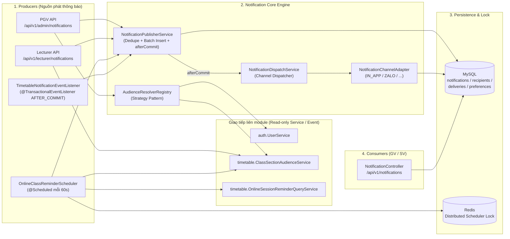
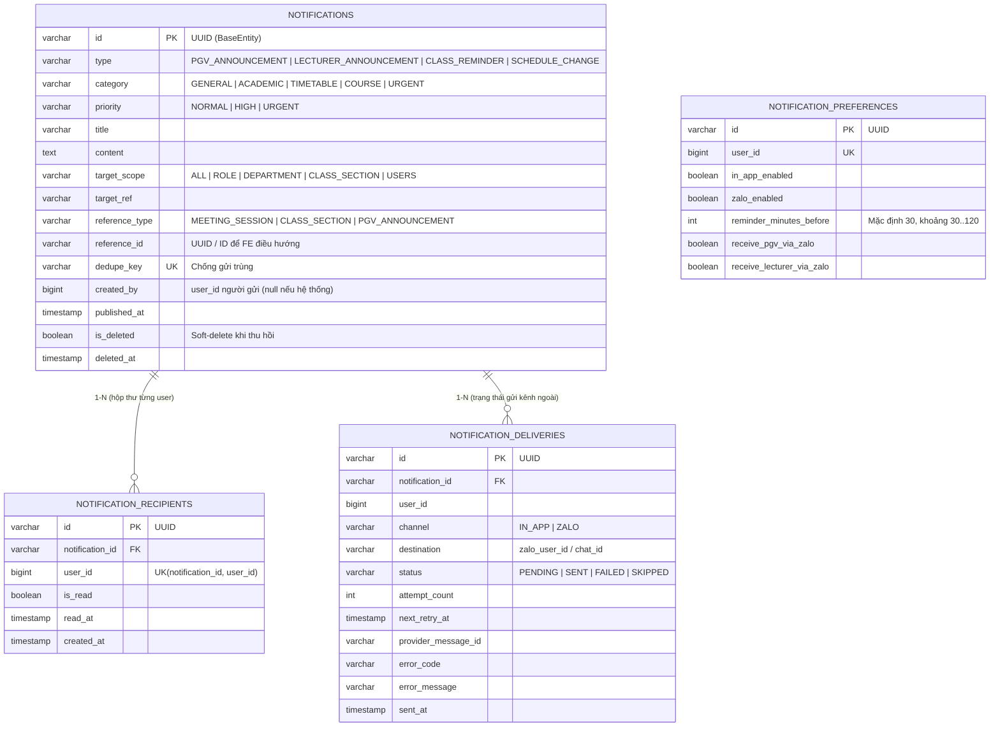
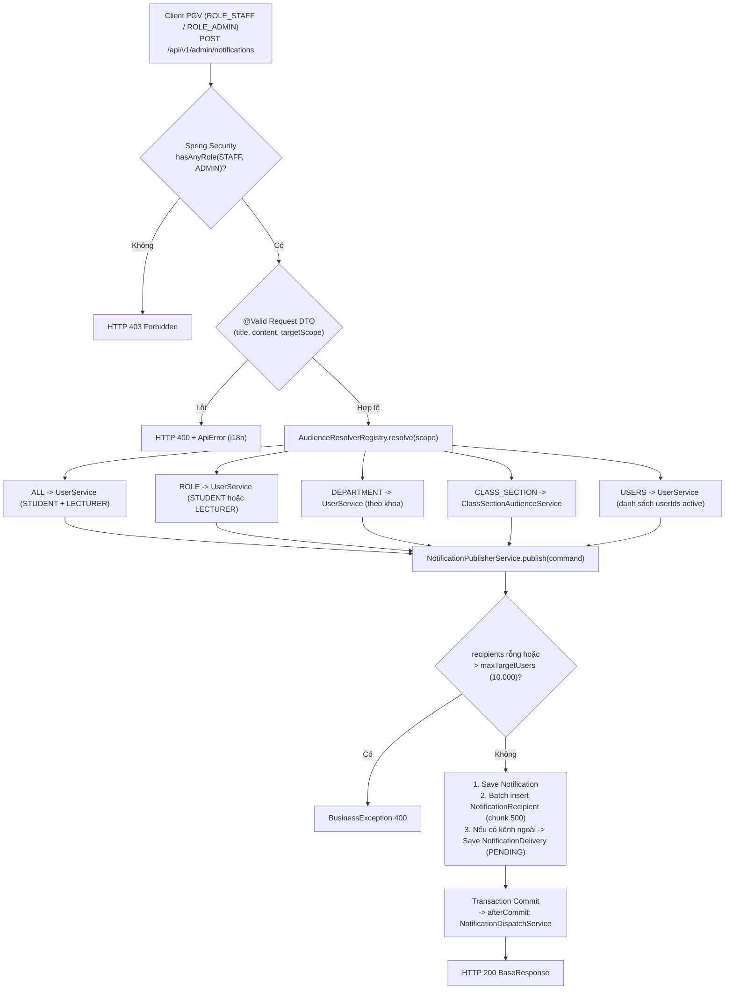
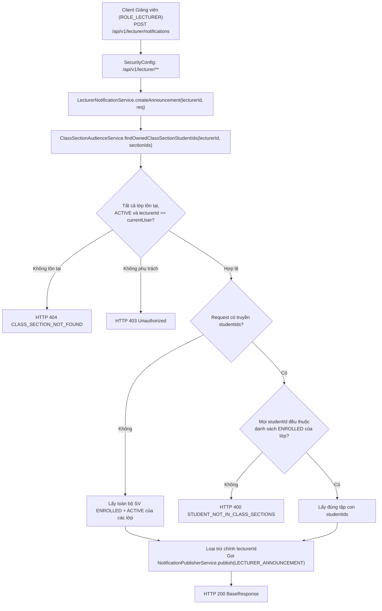
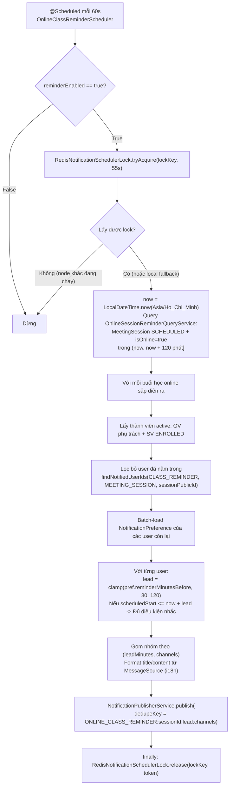
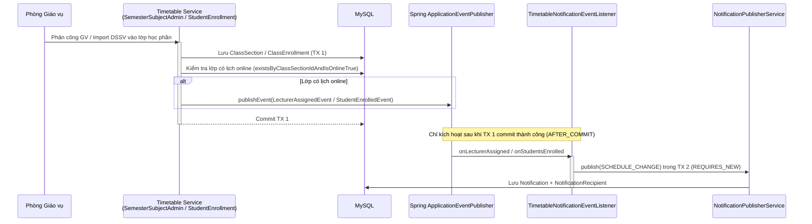
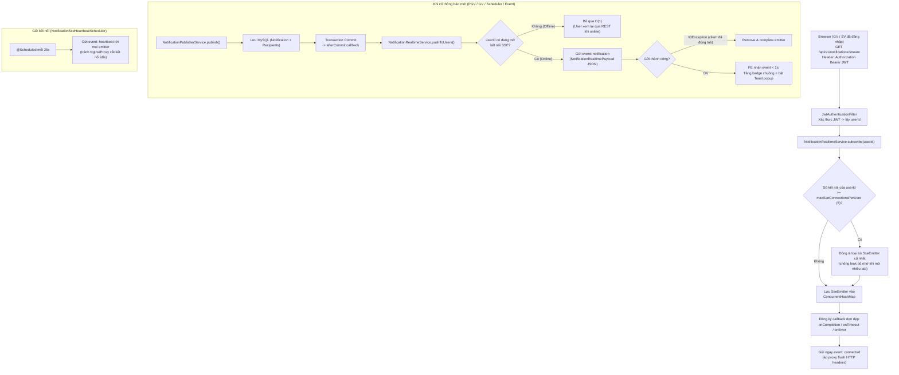

# Phân tích Kiến trúc & Luồng Nghiệp vụ Module Notification (Phase 1 – Phase 3)

Tài liệu này mô tả toàn bộ kiến trúc, thiết kế cơ sở dữ liệu, các design patterns, sơ đồ luồng (flowchart/sequence), hợp đồng Input/Output và bộ câu hỏi phân tích chuyên sâu (phục vụ bảo vệ đồ án & phỏng vấn kỹ thuật) cho module `org.ptit.meeting.modules.notification`.

---

## 1. Tổng quan Kiến trúc & Ranh giới Module

Module `notification` được xây dựng theo kiến trúc **package-by-feature kết hợp 3-layer nhẹ** (`Controller -> Service -> Repository`), tách bạch 4 lớp trách nhiệm:
1. **Producers (Nguồn tạo thông báo)**: Phòng Giáo vụ (`NotificationAdminService`), Giảng viên (`LecturerNotificationService`), Scheduler nhắc lịch online (`OnlineClassReminderService`), và Event Listeners (`TimetableNotificationEventListener`).
2. **Shared Core Engine (Lõi phát hành dùng chung)**: `NotificationPublisherService` tập trung xử lý chống trùng (`dedupeKey`), validate giới hạn người nhận, lưu `Notification`, batch-insert hộp thư `NotificationRecipient`, tạo bản ghi `NotificationDelivery` và kích hoạt gửi kênh ngoài sau khi transaction commit.
3. **Channel Adapters (Kênh gửi)**: `NotificationDispatchService` điều phối qua interface `NotificationChannelAdapter` (`InAppNotificationChannelAdapter`, sẵn sàng cắm thêm `ZaloChannelAdapter`, Email, FCM mà không sửa core).
4. **Consumers (Người nhận)**: Hộp thư cá nhân (`NotificationInboxService`) và cài đặt cá nhân (`NotificationPreferenceService`).



### Nguyên tắc ranh giới module quan trọng
- **Không truy cập chéo repository**: `modules.notification` tuyệt đối không inject `UserRepository`, `ClassSectionRepository` hay `MeetingSessionRepository`. Mọi truy vấn dữ liệu đều đi qua service công khai (`UserService`, `ClassSectionAudienceService`, `OnlineSessionReminderQueryService`).
- **Không tạo circular dependency**: `timetable` không gọi trực tiếp `notification`. Khi PGV phân công giảng viên hoặc ghi danh sinh viên vào lớp online, `timetable` chỉ phát Spring `ApplicationEvent` (`LecturerAssignedEvent`, `StudentEnrolledInClassSectionEvent`), còn `notification` tự lắng nghe.

---

## 2. Design Patterns & Nguyên tắc SOLID / DRY áp dụng

| Pattern / Nguyên tắc | Class / Interface trong code | Giải quyết vấn đề gì? |
|---|---|---|
| **Strategy Pattern** (OCP) | `AudienceResolver`, `AudienceResolverRegistry`, 5 resolver (`AllUsers`, `Role`, `Department`, `ClassSection`, `ExplicitUsers`) | PGV có nhiều phạm vi gửi khác nhau. Muốn thêm phạm vi mới (VD: theo Khóa `COHORT` hay Lớp hành chính) chỉ cần thêm 1 `@Component` mới, **không sửa `if/else`** trong `NotificationAdminServiceImpl`. |
| **Adapter Pattern** (DIP/OCP) | `NotificationChannelAdapter`, `InAppNotificationChannelAdapter`, `NotificationDispatchServiceImpl` | Tách biệt logic phát hành khỏi kỹ thuật từng kênh gửi. Phase 4 thêm Zalo Bot chỉ cần tạo `ZaloChannelAdapter` implement `NotificationChannelAdapter`. |
| **Template Method Pattern** (DRY) | `AbstractAnnouncementService` (cha của `NotificationAdminServiceImpl` & `LecturerNotificationServiceImpl`) | Gom toàn bộ logic dùng chung: chuẩn hóa phân trang, tìm kiếm kèm thống kê đã đọc, xem chi tiết, thu hồi (soft-delete). Lớp con chỉ override `verifyAccess(...)` theo đúng quyền vai trò. |
| **Single Responsibility (SRP)** | `NotificationPublisherServiceImpl`, `NotificationInboxServiceImpl`, `NotificationPreferenceServiceImpl`, `OnlineClassReminderServiceImpl` | Mỗi service chịu trách nhiệm đúng 1 vòng đời nghiệp vụ, dễ viết unit test độc lập. |
| **Externalized Config (No Hardcode)** | `NotificationProperties` (`application.yml`), `NotificationErrorConstants`, `i18n/messages*.properties` | Toàn bộ ngưỡng batch size, max users, min/max phút nhắc (`30..120`), lock TTL, timezone và nội dung thông báo đều cấu hình được và hỗ trợ đa ngôn ngữ (`vi`/`en`). |
| **Deterministic Time (Testability)** | Inject `java.time.Clock` vào `OnlineClassReminderServiceImpl` | Unit test kiểm tra chính xác cửa sổ 30 phút / 45 phút mà không phụ thuộc đồng hồ hệ thống. |

---

## 3. Thiết kế Cơ sở dữ liệu (ER Diagram)



**Vì sao tách `notifications` và `notification_recipients`?**
- Khi PGV gửi thông báo toàn trường (VD: 10.000 SV), nội dung `title`/`content` chỉ lưu **1 bản ghi duy nhất** ở `notifications`, còn `notification_recipients` chỉ lưu `(notification_id, user_id, is_read, read_at)` → tiết kiệm dung lượng DB, thống kê `readCount`/`totalRecipients` cực nhanh, và thu hồi thông báo chỉ cần update `is_deleted = true` ở đúng 1 dòng `notifications`.

---

## 4. Phân tích chi tiết 5 Luồng Nghiệp vụ (Flowchart + Input/Output)

### Luồng 1: Phòng Giáo vụ gửi thông báo (`POST /api/v1/admin/notifications`)



- **Input mẫu (`AdminAnnouncementCreateRequest`)**:
```json
{
  "title": "Thông báo lịch thi giữa kỳ",
  "content": "Sinh viên kiểm tra lịch thi từ ngày 01/12.",
  "category": "ACADEMIC",
  "priority": "HIGH",
  "targetScope": "ROLE",
  "targetRole": "STUDENT",
  "channels": ["IN_APP"]
}
```
- **Output mẫu (`BaseResponse<AnnouncementResponse>`)**:
```json
{
  "code": "0",
  "strCode": "success",
  "message": "SUCCESSFUL",
  "content": {
    "id": "b1f2c3d4-...",
    "type": "PGV_ANNOUNCEMENT",
    "category": "ACADEMIC",
    "priority": "HIGH",
    "title": "Thông báo lịch thi giữa kỳ",
    "targetScope": "ROLE",
    "targetRef": "STUDENT",
    "createdBy": 1,
    "totalRecipients": 1250,
    "readCount": 0
  }
}
```

---

### Luồng 2: Giảng viên gửi thông báo tới lớp phụ trách (`POST /api/v1/lecturer/notifications`)



- **Input mẫu (`LecturerAnnouncementCreateRequest`)**:
```json
{
  "title": "Nhắc nộp bài tập thực hành buổi 3",
  "content": "Các em nộp bài trước 23:59 tối nay.",
  "category": "COURSE",
  "priority": "NORMAL",
  "classSectionIds": [10],
  "studentIds": [201, 202],
  "channels": ["IN_APP"]
}
```
- **Kiểm soát quyền xem/thu hồi**: Khi giảng viên gọi `GET` hoặc `DELETE /api/v1/lecturer/notifications/{id}`, `verifyAccess(...)` kiểm tra bắt buộc `type == LECTURER_ANNOUNCEMENT` và `createdBy.equals(lecturerUserId)`.

---

### Luồng 3: Hộp thư cá nhân & Cài đặt (`GET /api/v1/notifications`)

- **Đọc hộp thư (`GET /api/v1/notifications?type=&category=&read=&page=0&size=20`)**:
  - Join `NotificationRecipient r` với `Notification n` nơi `r.userId = currentUserId` và `n.deleted = false`.
  - Trả về `PageResponseDTO<UserNotificationResponse>` gồm `recipientId`, `notificationId`, `type`, `title`, `content`, `referenceType`, `referenceId`, `read`, `readAt`, `publishedAt`.
- **Đếm chưa đọc (`GET /api/v1/notifications/unread-count`)**: Trả `{"unreadCount": 3}` (dùng index `(user_id, is_read, created_at)`).
- **Đánh dấu đã đọc**:
  - `PATCH /api/v1/notifications/{recipientId}/read`: tìm theo `(recipientId, currentUserId)` → chống IDOR (user A không thể đánh dấu đọc hộp thư của user B).
  - `PATCH /api/v1/notifications/read-all`: 1 câu bulk `UPDATE` trả về `{"markedCount": N}`.
- **Cài đặt cá nhân (`GET/PUT /api/v1/notifications/preferences`)**:
  - Nếu user chưa có bản ghi, trả cấu hình mặc định từ `NotificationProperties` (`reminderMinutesBefore = 30`).
  - Khi cập nhật, validate cứng `minReminderMinutes (30) <= reminderMinutesBefore <= maxReminderMinutes (120)`.

---

### Luồng 4: Scheduler nhắc lịch học trực tuyến tự động trước tối thiểu 30 phút



**Cơ chế chống gửi trùng (Idempotency) 3 lớp**:
1. **Redis Distributed Lock (`SET NX PX`)**: Ngăn nhiều instance backend cùng quét tại cùng một thời điểm; giải phóng khóa bằng Lua script kiểm tra đúng `token` sở hữu.
2. **Per-User Session Check (`findNotifiedUserIds`)**: Kiểm tra user đã được nhắc cho `sessionPublicId` chưa. Nhờ vậy, nếu user đã được nhắc lúc trước 45 phút rồi đổi cài đặt xuống 30 phút, hệ thống vẫn **không bao giờ nhắc lại lần 2**.
3. **Database Unique Constraint (`dedupe_key`)**: Tầng bảo vệ cuối cùng ở DB chống race condition.

---

### Luồng 5: Event Triggers tự động từ module `timetable`



---

### Luồng 6: Đẩy thông báo Realtime bằng Server-Sent Events (SSE)



---

## 5. Bộ câu hỏi Phỏng vấn thực chiến & Cách trả lời

### Câu 1: Làm sao hệ thống đảm bảo không gửi trùng thông báo nhắc lịch khi scale lên nhiều server (multi-instance)?
> **Trả lời**: Hệ thống dùng cơ chế phòng thủ **3 lớp**:
> 1. **Tầng điều phối**: Redis Distributed Lock (`SET key token NX PX ttl`) kèm Lua script unlock an toàn theo `token`, đảm bảo tại một thời điểm chỉ 1 instance quét lịch.
> 2. **Tầng nghiệp vụ**: Truy vấn `findNotifiedUserIds` theo `(CLASS_REMINDER, MEETING_SESSION, sessionPublicId)` để loại bỏ những user đã được nhắc (tránh nhắc lặp ngay cả khi user đổi cấu hình số phút nhắc).
> 3. **Tầng dữ liệu**: Cột `dedupe_key` có `UNIQUE constraint` trong bảng `notifications`, và `UNIQUE(notification_id, user_id)` trong `notification_recipients`.

### Câu 2: Khi Phòng Giáo vụ gửi thông báo tới 10.000 sinh viên, làm sao tránh treo HTTP request và tối ưu ghi DB?
> **Trả lời**:
> - Tách bảng `notifications` (1 dòng nội dung gốc) và `notification_recipients` (chỉ chứa FK + trạng thái đọc), tránh nhân bản `TEXT` content 10.000 lần.
> - Insert `notification_recipients` theo **batch** (chunk 500 cấu hình qua `NotificationProperties`, kết hợp `hibernate.jdbc.batch_size: 50` và `rewriteBatchedStatements=true` trên MySQL).
> - Có ngưỡng bảo vệ `maxTargetUsers` tránh OOM.
> - Gửi kênh ngoài (Zalo) chỉ chạy **sau khi DB transaction commit** (`TransactionSynchronizationManager.afterCommit`), không giữ DB connection trong lúc gọi HTTP API bên thứ ba (và ở Phase 4 có thể kết hợp `@Async` / retry scheduler).

### Câu 3: Tại sao Event Listener dùng `@TransactionalEventListener(AFTER_COMMIT)` kết hợp `@Transactional(REQUIRES_NEW)`?
> **Trả lời**:
> - Nếu dùng `@EventListener` thông thường chạy trong cùng transaction của `timetable`, khi transaction `timetable` bị rollback thì thông báo đã có thể bị phát nhầm; ngược lại nếu gửi thông báo lỗi thì lại làm rollback cả đợt import danh sách sinh viên của PGV.
> - `AFTER_COMMIT` đảm bảo chỉ gửi thông báo khi dữ liệu TKB đã lưu chắc chắn. Vì lúc đó TX 1 đã đóng, cần `REQUIRES_NEW` để mở TX 2 riêng cho việc lưu thông báo (và bọc `try/catch` log lỗi để không ảnh hưởng luồng chính).

### Câu 4: Tại sao không để `notification` gọi thẳng `UserRepository` hoặc `ClassSectionRepository` cho nhanh?
> **Trả lời**: Để giữ **encapsulation & loose coupling** giữa các module theo kiến trúc package-by-feature. Nếu `notification` chọc thẳng vào repository của `timetable` hay `auth`, mọi thay đổi schema/business rule (như điều kiện lớp `ACTIVE`, sinh viên `ENROLLED`, quyền phụ trách của giảng viên) sẽ bị nhân bản rải rác. Đi qua service công khai (`ClassSectionAudienceService`, `UserService`) giúp gom business rule vào đúng module sở hữu và dễ tách microservice sau này.

### Câu 5: Nếu sau này sếp yêu cầu thêm kênh gửi Email/Zalo hoặc thêm phạm vi gửi theo "Khóa tuyển sinh", bạn phải sửa code ở những đâu?
> **Trả lời**: Nhờ tuân thủ **Open/Closed Principle**:
> - Thêm kênh gửi mới (Zalo/Email): chỉ cần thêm enum vào `DeliveryChannel`, viết client kỹ thuật ở `integration.<provider>` và tạo 1 class implement `NotificationChannelAdapter` — **không sửa** `NotificationPublisherServiceImpl` hay `NotificationDispatchServiceImpl`.
> - Thêm phạm vi đối tượng mới (`COHORT`): chỉ cần thêm 1 class implement `AudienceResolver` — `AudienceResolverRegistry` tự động đăng ký qua Spring DI, **không sửa** `NotificationAdminServiceImpl`.

### Câu 6: Giảng viên có thể giả mạo request gửi thông báo tới lớp của giảng viên khác hoặc sinh viên không thuộc lớp mình không?
> **Trả lời**: Không, vì có **3 lớp kiểm tra**:
> 1. `SecurityConfig` chặn URL `/api/v1/lecturer/**` yêu cầu JWT có `ROLE_LECTURER`/`STAFF`/`ADMIN`.
> 2. `ClassSectionAudienceService.findOwnedClassSectionStudentIds` xác minh mọi `classSectionId` đều tồn tại, `ACTIVE` và có `lecturerId == currentUserId` (sai → `403`).
> 3. Nếu giảng viên truyền thêm `studentIds`, `LecturerNotificationServiceImpl` kiểm tra từng `studentId` có nằm trong tập sinh viên `ENROLLED` của đúng các lớp đó không (sai → `400`).

### Câu 7: Nếu Redis bị chết đột ngột thì Scheduler nhắc lịch có bị sập toàn bộ không?
> **Trả lời**: `RedisNotificationSchedulerLock` bắt `DataAccessException`, ghi log cảnh báo và trả về `LOCAL_FALLBACK` để scheduler vẫn chạy được ở chế độ đơn node thay vì bỏ lỡ nhắc lịch học của sinh viên; đồng thời lớp `findNotifiedUserIds` + `dedupe_key` ở MySQL vẫn tiếp tục bảo vệ chống gửi trùng.

### Câu 8: Làm sao bạn unit test các logic phụ thuộc thời gian thực (nhắc trước 30 phút / 45 phút)?
> **Trả lời**: `OnlineClassReminderServiceImpl` nhận `java.time.Clock` qua constructor (Spring dùng `Clock.systemDefaultZone()`, còn test truyền `Clock.fixed(...)`). Nhờ đó test chạy cực nhanh, hoàn toàn deterministic (ví dụ cố định đồng hồ ở `08:20` cho buổi học `09:00` để xác minh user cài `45 phút` được nhắc còn user mặc định `30 phút` chưa bị nhắc sớm).

### Câu 9: Tại sao chọn Server-Sent Events (SSE) thay vì WebSocket hay HTTP Polling cho Notification?
> **Trả lời**:
> - **So với Polling**: Polling gọi HTTP lặp lại liên tục gây tốn băng thông, tải DB cao và có độ trễ (30–60s). SSE đẩy tức thì (< 1s) khi có sự kiện thật.
> - **So với WebSocket**: WebSocket là giao tiếp 2 chiều (full-duplex) qua giao thức `ws://`, nặng hơn và cần cấu hình riêng (STOMP/broker, xử lý firewall/proxy phức tạp). Thông báo chỉ cần **1 chiều Server → Client**, nên SSE chạy ngay trên **HTTP/1.1 hoặc HTTP/2 chuẩn**, giữ nguyên cơ chế bảo mật JWT filter hiện có và cực nhẹ.

### Câu 10: SSE quản lý bộ nhớ, kết nối chết và bài toán scale nhiều server như thế nào?
> **Trả lời**:
> - **Chống memory leak**: Dùng `ConcurrentHashMap<Long, CopyOnWriteArrayList<SseEmitter>>`, giới hạn `maxSseConnectionsPerUser = 5` (mở quá tự đẩy tab cũ nhất), đăng ký đủ `onCompletion`/`onTimeout`/`onError`, và chạy `heartbeat` mỗi 25s để vừa chống Nginx cắt kết nối idle vừa phát hiện sớm `IOException` của tab đã đóng.
> - **Tránh đẩy dữ liệu chưa commit**: Chỉ gọi `realtimeService.pushToUsers(...)` trong `TransactionSynchronization.afterCommit()`.
> - **Khi scale nhiều instance backend**: Nếu User A kết nối SSE ở Server 1 nhưng PGV gọi API gửi ở Server 2, chỉ cần bổ sung **Redis Pub/Sub** (Server 2 publish payload lên channel Redis, mọi server subscribe nhận và đẩy xuống `SseEmitter` nội bộ nếu user đó đang kết nối trên mình).
