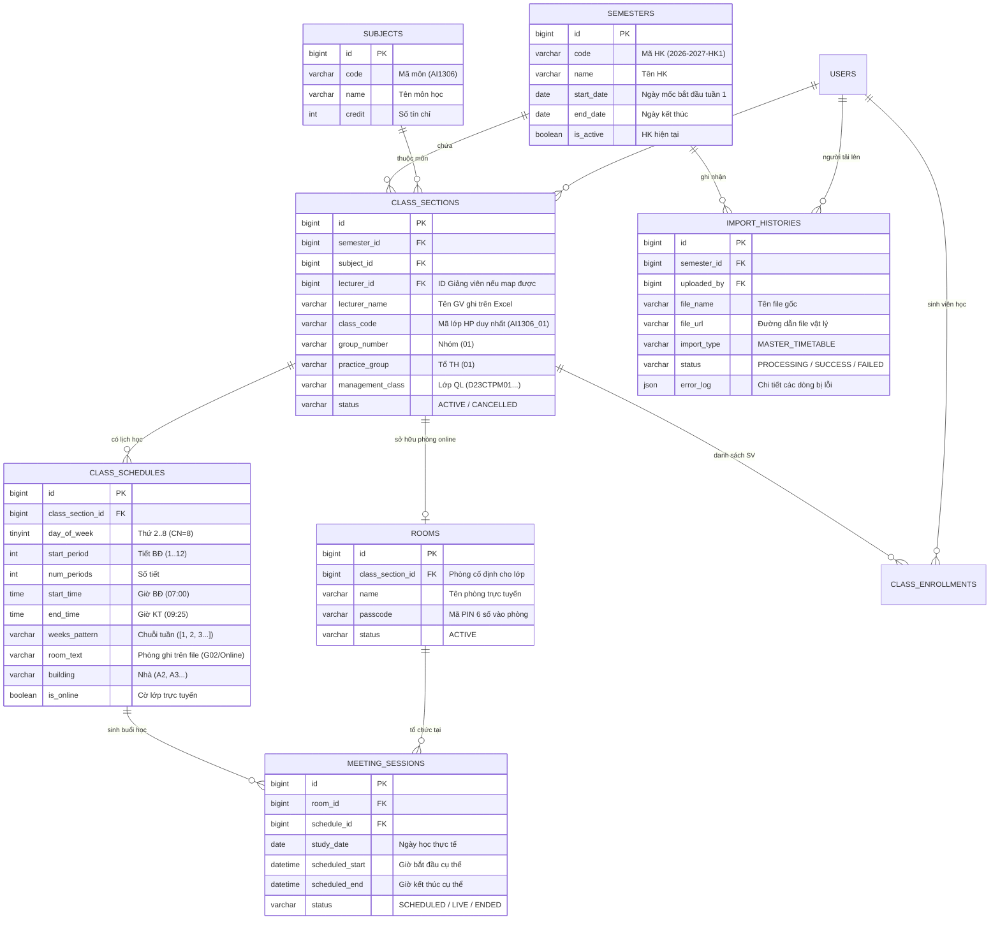
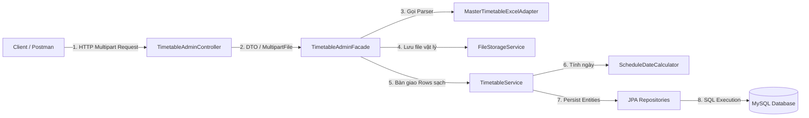
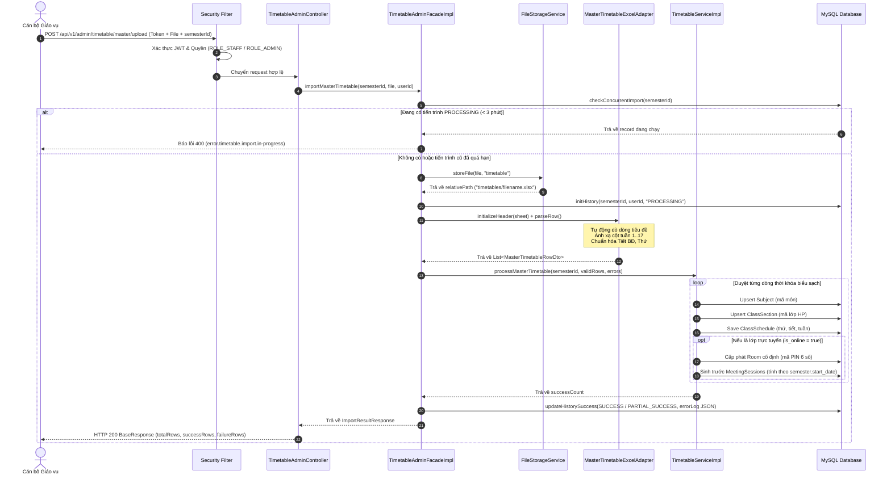

# PHÂN TÍCH & THIẾT KẾ GIẢI PHÁP IMPORT THỜI KHÓA BIỂU TỔNG (MASTER TIMETABLE)
## BUSINESS ANALYSIS & SYSTEM SOLUTION DESIGN DOCUMENT

> **Hệ thống:** PTIT Meeting — Nền tảng Phòng học số và Hội họp trực tuyến Học viện  
> **Phân hệ:** Quản lý Đào tạo & Thời khóa biểu (`org.ptit.meeting.modules.timetable`)  
> **Phiên bản tài liệu:** 3.0 (Chuẩn hóa toàn diện theo nghiệp vụ thực tế của PTIT)  
> **Tài liệu tham chiếu:** File Excel mẫu thực tế `1606_TKB-hoc-ky-1-nam-hoc-2026-2027.xlsx`  
> **Đối tượng tài liệu:** Kỹ sư phát triển mới (Onboarding Developers), Tester (QA/QC), Solution Architect  

---

## MỤC LỤC
1. [Bối cảnh Nghiệp vụ & Bài toán Đặt ra](#1-bối-cảnh-nghiệp-vụ--bài-toán-đặt-ra)
2. [Các Tác nhân & Ma trận Phân quyền (Actors & Permissions)](#2-các-tác-nhân--ma-trận-phân-quyền)
3. [Mô hình Dữ liệu Nghiệp vụ (Data Model & ERD)](#3-mô-hình-dữ-liệu-nghiệp-vụ)
4. [Kiến trúc Giải pháp & Nguyên tắc Thiết kế (Software Architecture)](#4-kiến-trúc-giải-pháp--nguyên-tắc-thiết-kế)
5. [Đặc tả Luồng Nghiệp vụ Chi tiết (Detailed Business Flow)](#5-đặc-tả-luồng-nghiệp-vụ-chi-tiết)
6. [Đặc tả Cấu trúc File Excel Thời Khóa Biểu PTIT](#6-đặc-tả-cấu-trúc-file-excel-thời-khóa-biểu-ptit)
7. [Thuật toán Xử lý Excel Thông minh (Adapter Pattern)](#7-thuật-toán-xử-lý-excel-thông-minh)
8. [Thuật toán Tính Ngày Học & Sinh Buổi Học Số](#8-thuật-toán-tính-ngày-học--sinh-buổi-học-số)
9. [Đặc tả Giao diện API (REST API Specification)](#9-đặc-tả-giao-diện-api)
10. [Cơ chế Chống Đụng độ & Tự Phục hồi (Concurrency & Resilience)](#10-cơ-chế-chống-đụng-độ--tự-phục-hồi)
11. [Hướng dẫn Cài đặt & Kiểm thử cho Người Mới (Onboarding Guide)](#11-hướng-dẫn-cài-đặt--kiểm-thử-cho-người-mới)

---

## 1. BỐI CẢNH NGHIỆP VỤ & BÀI TOÁN ĐẶT RA

### 1.1. Bối cảnh
Tại Học viện Công nghệ Bưu chính Viễn thông (PTIT), vào đầu mỗi học kỳ, Phòng Giáo vụ tiếp nhận dữ liệu xếp thời khóa biểu tổng từ phần mềm quản lý đào tạo. Dữ liệu này được kết xuất dưới dạng bảng tính Excel (`.xlsx`) chứa hàng nghìn dòng, bao gồm toàn bộ lịch học của các khóa, ngành, môn học và giảng viên trong suốt kỳ học (15–17 tuần).

Trong mô hình đào tạo kết hợp (Blended Learning) và chuyển đổi số phòng học:
- **Lớp học phần truyền thống (Offline):** Diễn ra tại các giảng đường vật lý (như `301-A2`, `402-A3`...).
- **Lớp học phần trực tuyến (Online):** Diễn ra trên nền tảng số PTIT Meeting (ký hiệu phòng học trong file Excel là `Online` hoặc `ONLINE`).

### 1.2. Yêu cầu bài toán
Hệ thống PTIT Meeting Backend cần cung cấp API cho phép Cán bộ Phòng Giáo vụ tải lên (upload) file Excel Thời khóa biểu tổng để tự động:
1. **Lưu trữ file đối soát:** Lưu file gốc an toàn trên hệ thống tệp tin (`uploads/timetables/`) để phục vụ kiểm toán đào tạo.
2. **Cập nhật danh mục Môn học (`subjects`):** Tự động thêm mới các môn học xuất hiện trong file nếu chưa có trong hệ thống.
3. **Quản lý Lớp học phần (`class_sections`):** Tạo các lớp học phần tương ứng cho từng nhóm, tổ thực hành, gán thông tin giảng viên và mã lớp quản lý.
4. **Lưu trữ Lịch học cố định theo tuần (`class_schedules`):** Lưu thứ, tiết học, thời gian bắt đầu/kết thúc, chuỗi tuần học hoạt động và phòng học.
5. **Cấp phát Phòng học số (`rooms`):** Đối với các lớp học trực tuyến (`is_online = true`), tự động cấp một phòng họp số cố định kèm mã PIN ngẫu nhiên bảo mật.
6. **Tự động sinh các Buổi học số (`meeting_sessions`):** Dựa vào ngày bắt đầu của học kỳ (`semesters.start_date`), tính toán chính xác ngày dương lịch của từng buổi học số theo từng tuần và sinh sẵn lịch trong CSDL.

### 1.3. Thách thức kỹ thuật của file Excel thực tế
File Excel của PTIT không phải là bảng dữ liệu thô dạng bảng đơn giản (flat table) mà có cấu trúc nghiệp vụ phức tạp:
- **Dòng tiêu đề trôi (Dynamic Header):** 4 dòng đầu là banner Học viện và thông tin quyết định đào tạo; dòng tiêu đề nằm ở Dòng 7.
- **Tiêu đề cột tuần học nằm ngang:** Dòng 5 chứa dãy số tuần $1, 2, 3... 17$, các dòng bên dưới đánh dấu chữ `'x'` tại các tuần lớp có lịch học.
- **Dòng thông tin phụ xen kẽ:** Dòng 8 và 9 chứa ngày bắt đầu, ngày kết thúc của tuần; nếu duyệt ngây thơ sẽ bị nhầm lẫn ngày (như ngày 18, 19, 20...) thành số tuần.
- **Tiếng Việt có dấu:** Các ký tự đặc thù như chữ `Đ`/`đ` trong `Tiết BĐ` nếu chuẩn hóa chuỗi không đúng sẽ bị xóa mất, gây lỗi không nhận diện được tiêu đề.

---

## 2. CÁC TÁC NHÂN & MA TRẬN PHÂN QUYỀN

| Vai trò (Role) | Mã quyền trong hệ thống | Quyền hạn trong chức năng này |
| :--- | :--- | :--- |
| **Cán bộ Phòng Giáo vụ** | `ROLE_STAFF` | Upload file TKB học kỳ, theo dõi tiến độ import, xem báo cáo lỗi từng dòng. |
| **Quản trị viên hệ thống** | `ROLE_ADMIN` | Toàn quyền upload, kiểm tra lịch sử import, bảo trì dữ liệu. |
| **Giảng viên** | `ROLE_LECTURER` | *Chỉ xem (Read-only):* Sau khi import xong, đăng nhập vào hệ thống sẽ thấy danh sách lớp và phòng học số của mình. |
| **Sinh viên** | `ROLE_STUDENT` | *Chỉ xem (Read-only):* Sau khi có dữ liệu ghi danh (Giai đoạn 2), sinh viên vào phòng học theo TKB cá nhân. |

> [!NOTE]  
> Phân quyền được cấu hình tập trung tại `SecurityConfig.java`:  
> `.requestMatchers("/api/v1/admin/**").hasAnyRole("STAFF", "ADMIN")`  
> Người dùng phải gửi kèm JWT Access Token trong header `Authorization: Bearer <token>`.

---

## 3. MÔ HÌNH DỮ LIỆU NGHIỆP VỤ

Mô hình dữ liệu tuân thủ nguyên tắc **Flat ID Reference** (liên kết khóa ngoại dạng ID nguyên thủy thay vì nhúng trực tiếp Entity phức tạp) nhằm đạt hiệu năng tối đa và tránh vòng lặp tuần hoàn (circular dependency).



---

## 4. KIẾN TRÚC GIẢI PHÁP & NGUYÊN TẮC THIẾT KẾ

### 4.1. Kiến trúc phân tầng (Package-by-Feature)
Hệ thống tuân thủ nghiêm ngặt mô hình 4 tầng phân lập trách nhiệm rõ ràng:



### 4.2. Các nguyên tắc thiết kế nòng cốt (Design Principles)
1. **Single Responsibility (SRP):**
   - `Controller`: Chỉ nhận HTTP request, trích xuất token, bọc kết quả vào `BaseResponse`.
   - `Facade`: Đảm nhiệm workflow điều phối: kiểm tra lock đồng thời, lưu file vật lý, quản lý bản ghi `ImportHistory`.
   - `Adapter`: Độc lập hoàn toàn với Spring Data/DB; chỉ làm 1 việc duy nhất: đọc InputStream của file Excel bằng Apache POI và trả về `List<MasterTimetableRowDto>`.
   - `Service`: Chứa toàn bộ logic đào tạo và quy tắc nghiệp vụ CSDL trong `@Transactional`.
2. **Open/Closed Principle (OCP):**
   - Sử dụng **Adapter Pattern** kết hợp `ExcelAdapterFactory`. Khi Học viện ban hành định dạng file mới (hoặc import dữ liệu Sinh viên `STUDENT_ENROLLMENT`), chỉ cần tạo thêm class Adapter mới kế thừa `ExcelImportAdapter<T>` mà không phải chỉnh sửa code controller hay facade hiện có.
3. **Tính Bất biến & Chạy lại an toàn (Idempotency):**
   - Áp dụng kỹ thuật **Upsert** (tìm trước, nếu có thì giữ nguyên/cập nhật, nếu chưa có thì thêm mới) trên `Subject` và `ClassSection` dựa trên `(class_code, semester_id)`.
   - Khi Phòng Giáo vụ upload lại file cùng kỳ, hệ thống không làm nhân đôi dữ liệu.

---

## 5. ĐẶC TẢ LUỒNG NGHIỆP VỤ CHI TIẾT



---

## 6. ĐẶC TẢ CẤU TRÚC FILE EXCEL THỜI KHÓA BIỂU PTIT

Căn cứ trên file chuẩn mẫu [`1606_TKB-hoc-ky-1-nam-hoc-2026-2027.xlsx`](file:///home/huepth/Documents/Project/HuePTH/ptit-meeting-backend/1606_TKB-hoc-ky-1-nam-hoc-2026-2027.xlsx):

| Dòng Excel | Chỉ số (0-index) | Nội dung & Vai trò nghiệp vụ | Cách Adapter xử lý |
| :--- | :--- | :--- | :--- |
| **Dòng 1 - 4** | 0 - 3 | Tiêu đề Học viện, tên bảng lịch giảng dạy. | Bỏ qua (Skip). |
| **Dòng 5** | 4 | **Dãy số tuần học:** Chứa số thứ tự tuần $1, 2, 3... 17$ liên tiếp (từ cột `R` đến cột `AH`). | Thuật toán quét chuỗi liên tục để ánh xạ: `Week -> Column Index`. |
| **Dòng 6** | 5 | Tuần lịch trong năm (ví dụ tuần 23 đến 39). | Bỏ qua (không dùng làm tuần học kỳ). |
| **Dòng 7** | 6 | **Dòng Tiêu đề chính (Header Row):** Tên các cột thuộc tính môn học, lớp học. | Dò tìm tự động bằng 3 từ khóa: `mamon`, `thu`, `tietbd`. |
| **Dòng 8 - 9** | 7 - 8 | Ngày bắt đầu và ngày kết thúc tương ứng của từng tuần. | Bỏ qua (ngày học sẽ do hệ thống tự tính chuẩn hóa từ `start_date`). |
| **Dòng 10 - 11** | 9 - 10 | Tuần học lặp lại và các công thức phụ. | Bỏ qua. |
| **Dòng 12 trở đi**| 11..End | **Dữ liệu thời khóa biểu chi tiết** của từng lớp học phần. | Duyệt từng dòng để trích xuất dữ liệu đưa vào DTO. |

### Bảng đối chiếu các cột nghiệp vụ chính (Tại Dòng 7)
* Cột `B` (index 1): **Mã môn học** $\rightarrow$ `subjectCode` (ví dụ: `AI1306`).
* Cột `C` (index 2): **Tên môn học/học phần** $\rightarrow$ `subjectName` (ví dụ: `Khoa học dữ liệu cơ bản`).
* Cột `D` (index 3): **Khóa** $\rightarrow$ `cohort` (ví dụ: `2025`).
* Cột `G` (index 6): **Nhóm** $\rightarrow$ `groupNumber` (ví dụ: `01`).
* Cột `I` (index 8): **Tổ TH** $\rightarrow$ `practiceGroup` (nếu có, ví dụ: `01`).
* Cột `J` (index 9): **Thứ** $\rightarrow$ `dayOfWeek` (giá trị số từ $2$ đến $8$; Chủ nhật là 8).
* Cột `K` (index 10): **Tiết BĐ** $\rightarrow$ `startPeriod` (tiết từ $1$ đến $12$).
* Cột `L` (index 11): **Số tiết** $\rightarrow$ `numPeriods` (ví dụ: $2$ hoặc $3$).
* Cột `M` (index 12): **Giảng viên giảng dạy** $\rightarrow$ `lecturerName`.
* Cột `R` - `AH` (index 17 - 33): **Các tuần học:** Ô nào có ký tự `'x'` hoặc `'X'` nghĩa là có lịch học ở tuần đó.
* Cột `AI` (index 34): **Phòng** $\rightarrow$ `roomText`. Nếu ô này ghi `Online` $\rightarrow$ Đánh dấu `is_online = true`.
* Cột `AJ` (index 35): **Nhà** $\rightarrow$ `building` (ví dụ: `A2`, `A3`).
* Cột `AK` (index 36): **Mã lớp** $\rightarrow$ `managementClass` (ví dụ: `D25CQTN01-B`).
* Cột `AL` (index 37): **Số TC** $\rightarrow$ `credit` (ví dụ: `3`).

---

## 7. THUẬT TOÁN XỬ LÝ EXCEL THÔNG MINH

Cài đặt chi tiết trong [`MasterTimetableExcelAdapter.java`](file:///home/huepth/Documents/Project/HuePTH/ptit-meeting-backend/src/main/java/org/ptit/meeting/modules/timetable/adapter/impl/MasterTimetableExcelAdapter.java):

### 7.1. Chuẩn hóa tiếng Việt & Xử lý ký tự `Đ`/`đ`
Khi người dùng lưu Excel tiếng Việt, các từ như `Tiết BĐ` chứa chữ `Đ` (Unicode `\u0111`). Nếu chỉ xóa dấu thanh diacritic bằng regex thông thường, chữ `Đ` sẽ bị xóa mất và biến thành `tietb` thay vì `tietbd`.

```java
private String normalize(String text) {
  if (text == null) return "";
  // Bước 1: Chuyển đổi ký tự Đ/đ độc lập sang d
  String s = text.replace("đ", "d").replace("Đ", "d");
  // Bước 2: Tách các dấu thanh tiếng Việt (NFD) và xóa dấu
  return Normalizer.normalize(s, Normalizer.Form.NFD)
      .replaceAll("\\p{InCombiningDiacriticalMarks}+", "")
      .toLowerCase()
      .replaceAll("[^a-z0-9]", ""); // Chỉ giữ lại a-z và 0-9
}
```

### 7.2. Quét dòng tiêu đề tự động (Dynamic Header Scanner)
Thay vì hard-code dòng số 7, Adapter tự động duyệt qua 25 dòng đầu tiên và nhận diện dòng tiêu đề khi chứa đủ 3 dấu hiệu đặc trưng:
```java
private int scanHeaderRow(Sheet sheet) {
  int maxScan = Math.min(25, sheet.getLastRowNum());
  for (int r = 0; r <= maxScan; r++) {
    Row row = sheet.getRow(r);
    if (row == null) continue;
    
    boolean hasSubject = false, hasDay = false, hasPeriod = false;
    for (Cell cell : row) {
      String text = normalize(getCellValueAsString(cell));
      if (text.contains("mamon") || text.contains("monhoc") || text.contains("hocphan")) hasSubject = true;
      if (text.equals("thu")) hasDay = true;
      if (text.contains("tietbd") || text.contains("tiet")) hasPeriod = true;
    }
    if (hasSubject && hasDay && hasPeriod) {
      log.info("(scanHeaderRow) Đã phát hiện dòng tiêu đề TKB tại dòng {} (index={})", r + 1, r);
      return r;
    }
  }
  throw BusinessException.invalidInputFile(TimetableErrorConstants.EXCEL_HEADER_INVALID);
}
```

### 7.3. Thuật toán nhận diện tuần học chính xác (Consecutive Week Sequence)
Để tránh đọc nhầm ngày $18, 19, 20...$ tại dòng ngày tháng, thuật toán tìm kiếm dãy số tăng dần liên tục $1, 2, 3...$:
```java
for (int c = 0; c < row.getLastCellNum() - 2; c++) {
  Integer val1 = getCellValueAsInteger(row.getCell(c));
  Integer val2 = getCellValueAsInteger(row.getCell(c + 1));
  Integer val3 = getCellValueAsInteger(row.getCell(c + 2));

  // Nhận diện chuỗi tuần 1, 2, 3 liên tiếp
  if (val1 != null && val1 == 1 && val2 != null && val2 == 2 && val3 != null && val3 == 3) {
    int week = 1;
    int col = c;
    while (col < row.getLastCellNum()) {
      Integer weekVal = getCellValueAsInteger(row.getCell(col));
      if (weekVal != null && weekVal == week) {
        weekToColMap.put(week, col);
        week++;
        col++;
      } else {
        break; // Kết thúc chuỗi tuần học
      }
    }
    return;
  }
}
```

---

## 8. THUẬT TOÁN TÍNH NGÀY HỌC & SINH BUỔI HỌC SỐ

### 8.1. Quy đổi Tiết học sang Khung giờ chuẩn PTIT
Cài đặt trong `MasterTimetableExcelAdapter`:

| Tiết học | Giờ bắt đầu (`startTime`) | Ghi chú |
| :---: | :---: | :--- |
| **Tiết 1** | `07:00` | Tiết 1 sáng |
| **Tiết 2** | `07:50` | Tiết 2 sáng |
| **Tiết 3** | `08:50` | Tiết 3 sáng (sau giờ ra chơi) |
| **Tiết 4** | `09:40` | Tiết 4 sáng |
| **Tiết 5** | `10:30` | Tiết 5 sáng |
| **Tiết 6** | `11:20` | Tiết 6 sáng |
| **Tiết 7** | `12:30` | Tiết 1 chiều |
| **Tiết 8** | `13:20` | Tiết 2 chiều |
| **Tiết 9** | `14:20` | Tiết 3 chiều (sau giờ ra chơi) |
| **Tiết 10** | `15:10` | Tiết 4 chiều |
| **Tiết 11** | `16:00` | Tiết 5 chiều |
| **Tiết 12** | `16:50` | Tiết 6 chiều |

* **Thời gian kết thúc:**  
  $$\text{endTime} = \text{startTime} + (\text{numPeriods} \times 50\text{ phút})$$

### 8.2. Công thức tính Ngày học thực tế
Cài đặt trong [`ScheduleDateCalculator.java`](file:///home/huepth/Documents/Project/HuePTH/ptit-meeting-backend/src/main/java/org/ptit/meeting/modules/timetable/service/ScheduleDateCalculator.java):
Giả sử Thứ Hai của Tuần 1 học kỳ là mốc `semesterStartDate`.
- Độ lệch theo Thứ: $\text{dayOffset} = \text{dayOfWeek} - 2$ (Thứ 2 có offset = 0, Thứ 3 = 1, ..., Chủ Nhật (8) = 6).
- Số ngày cần cộng thêm:
  $$\text{totalDaysToAdd} = ((\text{weekNumber} - 1) \times 7) + \text{dayOffset}$$
- Ngày học thực tế:
  $$\text{studyDate} = \text{semesterStartDate} + \text{totalDaysToAdd}$$

*Ví dụ:* Học kỳ 1 bắt đầu từ ngày Thứ Hai `10/08/2026`.
- Tuần 5, Thứ Ba (3):  
  $$\text{totalDaysToAdd} = (5 - 1) \times 7 + (3 - 2) = 28 + 1 = 29\text{ ngày}$$  
  $\rightarrow \text{studyDate} = 10/08/2026 + 29\text{ ngày} = 08/09/2026$.

---

## 9. ĐẶC TẢ GIAO DIỆN API

### 9.1. Endpoint Upload Thời khóa biểu
- **URL:** `POST /api/v1/admin/timetable/master/upload`
- **Quyền hạn:** `ROLE_STAFF` hoặc `ROLE_ADMIN`
- **Content-Type:** `multipart/form-data`

#### Request Parameters:
| Tên tham số | Kiểu dữ liệu | Bắt buộc | Mô tả |
| :--- | :--- | :---: | :--- |
| `file` | `MultipartFile` | **Có** | File Excel bảng tính TKB (.xlsx, .xls), tối đa 25MB. |
| `semesterId` | `Long` | **Có** | ID của học kỳ cần nạp TKB (ví dụ: `1`). |

#### Header:
```http
Authorization: Bearer <access_token>
```

#### Response Thành công (HTTP 200 OK):
```json
{
  "code": "0",
  "message": "Import thời khóa biểu tổng thành công.",
  "data": {
    "importId": 5,
    "fileName": "1606_TKB-hoc-ky-1-nam-hoc-2026-2027.xlsx",
    "fileSize": "871.92 KB",
    "semesterId": 1,
    "semesterCode": "2026-2027-HK1",
    "semesterName": "Học kỳ 1 năm học 2026 - 2027",
    "status": "PARTIAL_SUCCESS",
    "totalRows": 4471,
    "successRows": 4469,
    "failureRows": 2,
    "statistics": {
      "headerRow": 7,
      "dataStartRow": 12,
      "totalWeeksDetected": 17,
      "mappedColumnsCount": 13,
      "subjectsProcessed": 336,
      "classSectionsProcessed": 2334,
      "classSchedulesSaved": 4469,
      "onlineRoomsAllocated": 4,
      "meetingSessionsGenerated": 8
    },
    "errors": [
      {
        "rowNumber": 1557,
        "errorMessage": "Không có tuần học nào được đánh dấu 'x'"
      },
      {
        "rowNumber": 4233,
        "errorMessage": "Không có tuần học nào được đánh dấu 'x'"
      }
    ],
    "completedAt": "2026-10-16T01:45:00"
  }
}
```

#### Các mã lỗi nghiệp vụ chuẩn (`TimetableErrorConstants`):
| HTTP Status | Mã lỗi (`code` / `strCode`) | Mô tả chi tiết |
| :---: | :--- | :--- |
| `400` | `error.timetable.file.empty` | File tải lên không có nội dung hoặc rỗng. |
| `400` | `error.timetable.file.invalid-format` | File không thuộc định dạng được phép (.xlsx, .xls). |
| `400` | `error.timetable.excel.header-invalid` | Không tìm thấy dòng tiêu đề hợp lệ trong 25 dòng đầu. |
| `400` | `error.timetable.import.in-progress` | Học kỳ đang có một tiến trình upload khác đang chạy. |
| `404` | `error.timetable.semester.not-found` | Không tìm thấy học kỳ với ID chỉ định. |

---

## 10. CƠ CHẾ CHỐNG ĐỤNG ĐỘ & TỰ PHỤC HỒI

Nhằm đảm bảo an toàn tuyệt đối cho dữ liệu đào tạo:

1. **Khóa tiến trình đồng thời (Concurrency Lock):**
   Trước khi xử lý file, hệ thống kiểm tra bảng `import_histories`. Nếu học kỳ đó đang có một bản ghi ở trạng thái `PROCESSING`, API lập tức từ chối các request tiếp theo để tránh ghi đè dữ liệu.
2. **Cơ chế tự phục hồi tiến trình treo (Stale Job Recovery):**
   Nếu máy chủ bị khởi động lại (restart) hoặc mất điện đột ngột trong khi đang import dở, bản ghi cũ có thể bị kẹt ở trạng thái `PROCESSING`.
   Hàm `checkConcurrentImport()` tự động kiểm tra thời gian tạo: nếu bản ghi `PROCESSING` đã tồn tại **quá 3 phút**, hệ thống tự động đánh dấu bản ghi đó thành `FAILED` (kèm lý do `Tiến trình import bị gián đoạn`) và giải phóng khóa để cho phép người dùng upload lại ngay lập tức.
3. **Chuẩn hóa Log lỗi kiểu JSON:**
   Cột `error_log` trong MySQL có kiểu dữ liệu `JSON`. Mọi lỗi phát sinh đều được serialize qua Jackson `ObjectMapper` thành chuỗi JSON hợp lệ, ngăn chặn triệt để lỗi cú pháp `MySQL ERROR 3140: Invalid JSON text`.

---

## 11. HƯỚNG DẪN CÀI ĐẶT & KIỂM THỬ CHO NGƯỜI MỚI

### 11.1. Chuẩn bị Dữ liệu mẫu (Database Seeding)
Trước khi test API upload, cần đảm bảo CSDL MySQL đã có sẵn Học kỳ và Tài khoản Giáo vụ:

```sql
USE ptit_meeting;

-- 1. Tạo Học kỳ 1 năm học 2026 - 2027 (Ngày mốc: 10/08/2026)
INSERT INTO semesters (id, code, name, academic_year, semester_num, start_date, end_date, is_active)
VALUES (1, '2026-2027-HK1', 'Học kỳ 1 năm học 2026 - 2027', '2026-2027', 1, '2026-08-10', '2026-12-31', 1)
ON DUPLICATE KEY UPDATE code = VALUES(code);

-- 2. Tạo Tài khoản Giáo vụ (Mật khẩu: Ptit@123)
INSERT INTO users (id, email, password_hash, full_name, code, account_type, department, status, must_change_password)
VALUES (5, 'giaovu@ptit.edu.vn', '$2a$10$vH2cBAdgqXZqyFKPhlnn/ug/gzPHR9KKb0FPX2j8eT4cdVKpAKV7K', 
        'Cán bộ Phòng Giáo Vụ', 'GVU01', 'STAFF', 'Phòng Giáo vụ', 'ACTIVE', 0)
ON DUPLICATE KEY UPDATE email = VALUES(email);

-- 3. Gán quyền Giáo vụ (ROLE_STAFF = 3, ROLE_ADMIN = 4)
INSERT IGNORE INTO user_roles (user_id, role_id) VALUES (5, 3), (5, 4);
```

### 11.2. Các bước kiểm thử trên Postman
1. **Bước 1: Đăng nhập lấy Token**
   - **Method:** `POST`
   - **URL:** `http://localhost:8080/api/v1/auth/login`
   - **Body (JSON):**
     ```json
     {
       "username": "giaovu@ptit.edu.vn",
       "password": "Ptit@123"
     }
     ```
   - Copy chuỗi `accessToken` trả về trong response.

2. **Bước 2: Upload file Thời khóa biểu**
   - **Method:** `POST`
   - **URL:** `http://localhost:8080/api/v1/admin/timetable/master/upload`
   - **Headers:**
     - Tab **Authorization**: Type **Bearer Token** $\rightarrow$ Dán `accessToken`.
   - **Body:** Chọn tab **`form-data`**:
     - Key `file`: Chọn kiểu `File` $\rightarrow$ Chọn file [`1606_TKB-hoc-ky-1-nam-hoc-2026-2027.xlsx`](file:///home/huepth/Documents/Project/HuePTH/ptit-meeting-backend/1606_TKB-hoc-ky-1-nam-hoc-2026-2027.xlsx) trong thư mục gốc dự án.
     - Key `semesterId`: Chọn kiểu `Text` $\rightarrow$ Điền `1`.
   - Nhấn **Send** và xem kết quả tổng kết số môn học, số lớp học phần đã được import thành công.

### 11.3. Chạy Unit Test kiểm thử đọc file Excel
Để kiểm tra tính toàn vẹn của bộ Adapter mà không cần bật toàn bộ server, chạy lệnh Maven sau trong terminal:
```bash
mvn test -Dtest=MasterTimetableExcelAdapterTest
```
Kết quả mong đợi: `BUILD SUCCESS` (Dò đúng dòng tiêu đề Dòng 7, ánh xạ 13 cột, phát hiện 17 tuần học và đọc thành công dữ liệu).
