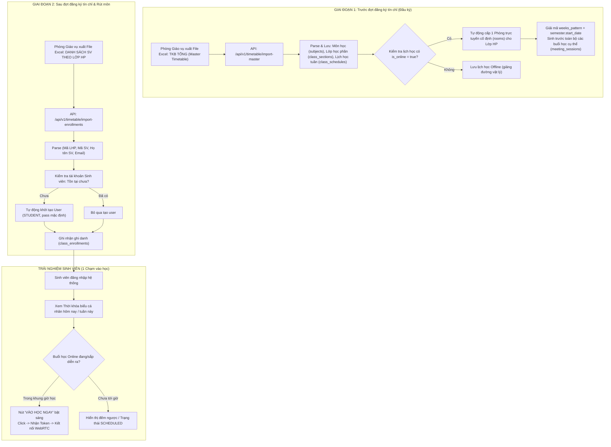
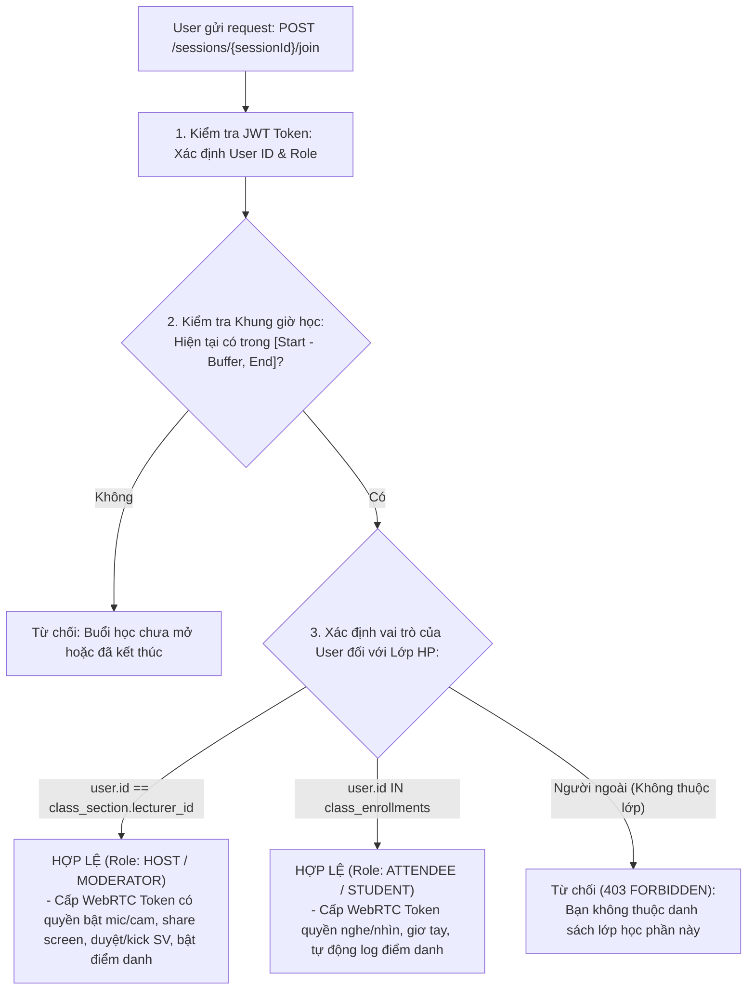

# TÀI LIỆU THIẾT KẾ GIẢI PHÁP PHÂN HỆ THỜI KHÓA BIỂU & PHÒNG HỌC ONLINE
## (TIMETABLE & ONLINE CLASS SOLUTION DESIGN)

**Hệ thống:** PTIT Meeting — Phòng học số và Hội họp trực tuyến  
**Phiên bản:** 1.0  
**Đối tượng sử dụng chính:** Phòng Giáo vụ (`ROLE_STAFF`/`ACADEMIC_AFFAIRS`), Giảng viên (`ROLE_LECTURER`), Sinh viên (`ROLE_STUDENT`)  
**Kiến trúc:** Layered & Flat ID Reference + Spring Boot 3 + MySQL 8 + Redis  

---

## 1. TỔNG QUAN NGHIỆP VỤ & QUY TRÌNH 2 GIAI ĐOẠN

Quy trình vận hành thời khóa biểu tại các trường đại học theo học chế tín chỉ (như PTIT) được chia làm **2 giai đoạn độc lập nhưng móc xích chặt chẽ**:



---

## 2. THIẾT KẾ CƠ SỞ DỮ LIỆU CHI TIẾT (MYSQL 8)

Tuân thủ nguyên tắc **Flat ID Reference** của dự án (sử dụng ID tham chiếu, không lạm dụng `@ManyToOne`/`@OneToMany` tự động fetch graph để tránh N+1 Query).

```sql
-- ========================================================
-- 1. BẢNG HỌC KỲ & NĂM HỌC (SEMESTERS)
-- Giải quyết triệt để bài toán: 1 năm có nhiều kỳ (kỳ 1, 2, hè)
-- và xác định mốc thời gian ngày bắt đầu tuần 1.
-- ========================================================
CREATE TABLE IF NOT EXISTS semesters (
    id            BIGINT AUTO_INCREMENT PRIMARY KEY,
    code          VARCHAR(50)  NOT NULL UNIQUE, -- VD: '2024-2025-HK1', '2024-2025-HE'
    name          VARCHAR(100) NOT NULL,        -- VD: 'Học kỳ 1 năm học 2024-2025'
    academic_year VARCHAR(20)  NOT NULL,        -- VD: '2024-2025'
    semester_num  TINYINT      NOT NULL,        -- 1: Kỳ 1, 2: Kỳ 2, 3: Kỳ hè
    start_date    DATE         NOT NULL,        -- BẮT BUỘC: Thứ Hai của Tuần 1 trong học kỳ
    end_date      DATE         NOT NULL,        -- Ngày kết thúc học kỳ
    is_active     BOOLEAN      NOT NULL DEFAULT FALSE, -- Kỳ học đang diễn ra
    created_at    DATETIME     NOT NULL DEFAULT CURRENT_TIMESTAMP,
    INDEX idx_semesters_active (is_active)
) ENGINE=InnoDB DEFAULT CHARSET=utf8mb4 COLLATE=utf8mb4_unicode_ci;

-- ========================================================
-- 2. BẢNG MÔN HỌC (SUBJECTS)
-- ========================================================
CREATE TABLE IF NOT EXISTS subjects (
    id          BIGINT AUTO_INCREMENT PRIMARY KEY,
    code        VARCHAR(30)  NOT NULL UNIQUE, -- VD: 'INT1306'
    name        VARCHAR(150) NOT NULL,        -- VD: 'Lập trình Web'
    credit      INT          NOT NULL DEFAULT 3,
    department  VARCHAR(150) NULL,            -- Khoa CNTT 1
    created_at  DATETIME     NOT NULL DEFAULT CURRENT_TIMESTAMP
) ENGINE=InnoDB DEFAULT CHARSET=utf8mb4 COLLATE=utf8mb4_unicode_ci;

-- ========================================================
-- 3. BẢNG LỚP HỌC PHẦN (CLASS_SECTIONS)
-- ========================================================
CREATE TABLE IF NOT EXISTS class_sections (
    id               BIGINT AUTO_INCREMENT PRIMARY KEY,
    semester_id      BIGINT       NOT NULL,
    subject_id       BIGINT       NOT NULL,
    lecturer_id      BIGINT       NULL,         -- Nullable: Đề phòng GV chưa phân công
    class_code       VARCHAR(50)  NOT NULL,     -- VD: 'INT1306_01'
    group_number     VARCHAR(20)  NULL,         -- Nhóm: '01'
    practice_group   VARCHAR(20)  NULL,         -- Tổ TH: '01' (nếu có)
    management_class VARCHAR(50)  NULL,         -- Lớp QLSV: 'D22CQCN01-B'
    status           VARCHAR(30)  NOT NULL DEFAULT 'ACTIVE', -- ACTIVE, CANCELLED, COMPLETED
    created_at       DATETIME     NOT NULL DEFAULT CURRENT_TIMESTAMP,
    updated_at       DATETIME     NOT NULL DEFAULT CURRENT_TIMESTAMP ON UPDATE CURRENT_TIMESTAMP,
    UNIQUE KEY uk_class_semester (class_code, semester_id),
    INDEX idx_class_lecturer (lecturer_id),
    INDEX idx_class_semester (semester_id),
    CONSTRAINT fk_cs_semester FOREIGN KEY (semester_id) REFERENCES semesters(id) ON DELETE CASCADE,
    CONSTRAINT fk_cs_subject  FOREIGN KEY (subject_id)  REFERENCES subjects(id) ON DELETE RESTRICT,
    CONSTRAINT fk_cs_lecturer FOREIGN KEY (lecturer_id) REFERENCES users(id) ON DELETE SET NULL
) ENGINE=InnoDB DEFAULT CHARSET=utf8mb4 COLLATE=utf8mb4_unicode_ci;

-- ========================================================
-- 4. BẢNG LỊCH HỌC ĐỊNH KỲ (CLASS_SCHEDULES)
-- Lưu thông tin tuần học, thứ, tiết lấy từ File Excel Master
-- ========================================================
CREATE TABLE IF NOT EXISTS class_schedules (
    id               BIGINT AUTO_INCREMENT PRIMARY KEY,
    class_section_id BIGINT       NOT NULL,
    day_of_week      TINYINT      NOT NULL,     -- 2: Thứ Hai, 3: Thứ Ba, ..., 8: Chủ Nhật
    start_period     INT          NOT NULL,     -- Tiết bắt đầu (1 -> 12)
    num_periods      INT          NOT NULL,     -- Số tiết (VD: 3)
    start_time       TIME         NOT NULL,     -- 07:00:00
    end_time         TIME         NOT NULL,     -- 09:25:00
    weeks_pattern    VARCHAR(100) NOT NULL,     -- VD: '1-10,12-16' hoặc '1234567890123456'
    room_text        VARCHAR(50)  NULL,         -- Phòng học offline (301-A2)
    building         VARCHAR(50)  NULL,         -- Giảng đường A2
    is_online        BOOLEAN      NOT NULL DEFAULT FALSE, -- CỜ QUAN TRỌNG: Lịch học Online
    created_at       DATETIME     NOT NULL DEFAULT CURRENT_TIMESTAMP,
    INDEX idx_schedules_class (class_section_id),
    INDEX idx_schedules_online (is_online),
    CONSTRAINT fk_sched_class FOREIGN KEY (class_section_id) REFERENCES class_sections(id) ON DELETE CASCADE
) ENGINE=InnoDB DEFAULT CHARSET=utf8mb4 COLLATE=utf8mb4_unicode_ci;

-- ========================================================
-- 5. BẢNG PHÒNG TRỰC TUYẾN CỐ ĐỊNH CỦA LỚP HP (ROOMS)
-- Mỗi LHP có lịch Online sẽ được cấp 1 phòng duy nhất
-- ========================================================
CREATE TABLE IF NOT EXISTS rooms (
    id                 BIGINT AUTO_INCREMENT PRIMARY KEY,
    class_section_id   BIGINT       NULL UNIQUE, -- 1 LHP chỉ có 1 phòng cố định
    created_by         BIGINT       NULL,        -- Người tạo (hoặc NULL nếu hệ thống sinh)
    name               VARCHAR(150) NOT NULL,    -- 'Phòng học trực tuyến - INT1306_01'
    external_engine_id VARCHAR(100) NULL,        -- Room ID bên WebRTC (LiveKit/Mediasoup)
    passcode           VARCHAR(20)  NULL,        -- Mã pin vào phòng (nếu cần)
    status             VARCHAR(30)  NOT NULL DEFAULT 'ACTIVE', -- ACTIVE, LOCKED
    created_at         DATETIME     NOT NULL DEFAULT CURRENT_TIMESTAMP,
    CONSTRAINT fk_room_class FOREIGN KEY (class_section_id) REFERENCES class_sections(id) ON DELETE CASCADE,
    CONSTRAINT fk_room_user  FOREIGN KEY (created_by) REFERENCES users(id) ON DELETE SET NULL
) ENGINE=InnoDB DEFAULT CHARSET=utf8mb4 COLLATE=utf8mb4_unicode_ci;

-- ========================================================
-- 6. BẢNG BUỔI HỌC CỤ THỂ (MEETING_SESSIONS)
-- Sinh tự động từ weeks_pattern + semester.start_date
-- ========================================================
CREATE TABLE IF NOT EXISTS meeting_sessions (
    id               BIGINT AUTO_INCREMENT PRIMARY KEY,
    room_id          BIGINT      NOT NULL,
    schedule_id      BIGINT      NOT NULL,
    study_date       DATE        NOT NULL,      -- Ngày học cụ thể
    scheduled_start  DATETIME    NOT NULL,      -- VD: 2024-09-19 07:00:00
    scheduled_end    DATETIME    NOT NULL,      -- VD: 2024-09-19 09:25:00
    actual_start     DATETIME    NULL,          -- Giờ GV bấm Bắt đầu buổi học
    actual_end       DATETIME    NULL,          -- Giờ kết thúc
    status           VARCHAR(30) NOT NULL DEFAULT 'SCHEDULED', -- SCHEDULED, LIVE, ENDED, CANCELLED
    created_at       DATETIME    NOT NULL DEFAULT CURRENT_TIMESTAMP,
    INDEX idx_sessions_lookup (study_date, status),
    INDEX idx_sessions_room (room_id),
    INDEX idx_sessions_schedule (schedule_id),
    CONSTRAINT fk_sess_room  FOREIGN KEY (room_id) REFERENCES rooms(id) ON DELETE CASCADE,
    CONSTRAINT fk_sess_sched FOREIGN KEY (schedule_id) REFERENCES class_schedules(id) ON DELETE CASCADE
) ENGINE=InnoDB DEFAULT CHARSET=utf8mb4 COLLATE=utf8mb4_unicode_ci;

-- ========================================================
-- 7. BẢNG DANH SÁCH SINH VIÊN THEO LỚP HP (CLASS_ENROLLMENTS)
-- Nạp từ Giai đoạn 2 (Sau đợt đăng ký tín chỉ)
-- ========================================================
CREATE TABLE IF NOT EXISTS class_enrollments (
    id               BIGINT AUTO_INCREMENT PRIMARY KEY,
    class_section_id BIGINT      NOT NULL,
    student_id       BIGINT      NOT NULL,
    status           VARCHAR(30) NOT NULL DEFAULT 'ENROLLED', -- ENROLLED, DROPPED
    enrolled_at      DATETIME    NOT NULL DEFAULT CURRENT_TIMESTAMP,
    UNIQUE KEY uk_enrollment (class_section_id, student_id),
    INDEX idx_enrollment_student (student_id),
    INDEX idx_enrollment_class (class_section_id),
    CONSTRAINT fk_enr_class   FOREIGN KEY (class_section_id) REFERENCES class_sections(id) ON DELETE CASCADE,
    CONSTRAINT fk_enr_student FOREIGN KEY (student_id) REFERENCES users(id) ON DELETE CASCADE
) ENGINE=InnoDB DEFAULT CHARSET=utf8mb4 COLLATE=utf8mb4_unicode_ci;

-- ========================================================
-- 8. BẢNG ĐIỂM DANH SINH VIÊN (ATTENDANCE_RECORDS)
-- ========================================================
CREATE TABLE IF NOT EXISTS attendance_records (
    id               BIGINT AUTO_INCREMENT PRIMARY KEY,
    session_id       BIGINT      NOT NULL,
    student_id       BIGINT      NOT NULL,
    status           VARCHAR(30) NOT NULL DEFAULT 'ABSENT', -- PRESENT, ABSENT, LATE, EXCUSED
    attended_minutes INT         NOT NULL DEFAULT 0,
    checked_by       BIGINT      NULL, -- Giảng viên duyệt hoặc NULL nếu auto WebRTC
    updated_at       DATETIME    NOT NULL DEFAULT CURRENT_TIMESTAMP ON UPDATE CURRENT_TIMESTAMP,
    UNIQUE KEY uk_session_student (session_id, student_id),
    INDEX idx_att_session (session_id),
    INDEX idx_att_student (student_id),
    CONSTRAINT fk_att_session FOREIGN KEY (session_id) REFERENCES meeting_sessions(id) ON DELETE CASCADE,
    CONSTRAINT fk_att_student FOREIGN KEY (student_id) REFERENCES users(id) ON DELETE CASCADE
) ENGINE=InnoDB DEFAULT CHARSET=utf8mb4 COLLATE=utf8mb4_unicode_ci;

-- ========================================================
-- 9. BẢNG LỊCH SỬ IMPORT (IMPORT_HISTORIES)
-- Lưu vết và log chi tiết lỗi JSON cho giáo vụ
-- ========================================================
CREATE TABLE IF NOT EXISTS import_histories (
    id           BIGINT AUTO_INCREMENT PRIMARY KEY,
    semester_id  BIGINT       NOT NULL,
    uploaded_by  BIGINT       NOT NULL,
    file_name    VARCHAR(255) NOT NULL,
    file_url     VARCHAR(500) NULL,
    import_type  VARCHAR(50)  NOT NULL, -- 'MASTER_TIMETABLE', 'STUDENT_ENROLLMENT'
    total_rows   INT          NOT NULL DEFAULT 0,
    success_rows INT          NOT NULL DEFAULT 0,
    failed_rows  INT          NOT NULL DEFAULT 0,
    status       VARCHAR(30)  NOT NULL DEFAULT 'PROCESSING', -- PROCESSING, SUCCESS, FAILED, PARTIAL_SUCCESS
    error_log    JSON         NULL,     -- Mảng JSON lưu chi tiết các dòng lỗi
    created_at   DATETIME     NOT NULL DEFAULT CURRENT_TIMESTAMP,
    CONSTRAINT fk_imp_semester FOREIGN KEY (semester_id) REFERENCES semesters(id) ON DELETE CASCADE,
    CONSTRAINT fk_imp_user     FOREIGN KEY (uploaded_by) REFERENCES users(id) ON DELETE CASCADE
) ENGINE=InnoDB DEFAULT CHARSET=utf8mb4 COLLATE=utf8mb4_unicode_ci;
```

---

## 3. THUẬT TOÁN SINH LỊCH HỌC ONLINE (`SCHEDULE GENERATOR`)

### 3.1. Thuật toán phân tích chuỗi tuần (`weeks_pattern`)
Định dạng tuần học tại PTIT thường có 2 dạng phổ biến:
1. **Dạng danh sách tuần (Range list):** `1-10, 12-16` hoặc `1,2,3,4,5,7,8`.
2. **Dạng chuỗi vị trí (Position string):** `12345678-012345--` (trong đó dấu `-` hoặc `_` là tuần nghỉ).

**Thuật toán Parse ra tập hợp số tuần (`Set<Integer> activeWeeks`):**
```java
public Set<Integer> parseWeeksPattern(String pattern) {
    Set<Integer> weeks = new TreeSet<>();
    if (pattern == null || pattern.isBlank()) return weeks;

    // Trường hợp 1: Dạng "1-10,12-16"
    if (pattern.contains(",") || pattern.contains("-")) {
        String[] parts = pattern.split(",");
        for (String part : parts) {
            String trimmed = part.trim();
            if (trimmed.contains("-")) {
                String[] range = trimmed.split("-");
                int start = Integer.parseInt(range[0].trim());
                int end = Integer.parseInt(range[1].trim());
                for (int w = start; w <= end; w++) weeks.add(w);
            } else {
                weeks.add(Integer.parseInt(trimmed));
            }
        }
    } 
    // Trường hợp 2: Dạng chuỗi ký tự "12345678-012..."
    else {
        for (int i = 0; i < pattern.length(); i++) {
            char c = pattern.charAt(i);
            if (Character.isDigit(c)) {
                weeks.add(i + 1); // Tuần thứ (i + 1)
            }
        }
    }
    return weeks;
}
```

### 3.2. Thuật toán tính ngày học cụ thể (`study_date`)
Dựa vào `semester.getStartDate()` (ngày Thứ Hai của Tuần 1):

```java
public LocalDate calculateStudyDate(LocalDate semesterStartDate, int weekNumber, int dayOfWeek) {
    // dayOfWeek: 2 = Thứ Hai, 3 = Thứ Ba, ..., 8 = Chủ Nhật
    long daysFromStartOfWeek = dayOfWeek - 2; 
    long daysFromSemesterStart = ((long)(weekNumber - 1) * 7) + daysFromStartOfWeek;
    return semesterStartDate.plusDays(daysFromSemesterStart);
}
```

---

## 4. CHI TIẾT XỬ LÝ IMPORT EXCEL (PHÒNG GIÁO VỤ)

### 4.1. Giai đoạn 1: Import TKB Tổng (`import-master`)
- **Tập tin đầu vào:** File Excel Thời khóa biểu học kỳ do phòng Giáo vụ xuất từ phần mềm Quản lý Đào tạo.
- **Các cột cần đọc:**
  - `Mã môn`, `Tên môn`, `Số tín chỉ`
  - `Mã Lớp HP`, `Nhóm`, `Tổ`, `Lớp QLSV`
  - `Mã Giảng viên`, `Tên Giảng viên`, `Email GV` (nếu có)
  - `Thứ`, `Tiết bắt đầu`, `Số tiết`, `Giờ bắt đầu`, `Giờ kết thúc`
  - `Phòng học`, `Tuần học`, `Hình thức` (hoặc kiểm tra phòng học có chứa chữ "Online", "Trực tuyến", "Teams" hoặc cờ `is_online = true`)
- **Quy trình xử lý:**
  1. Kiểm tra / Tự động thêm môn học vào `subjects` nếu chưa có.
  2. Map Giảng viên qua `users.code` = `Mã Giảng viên`. Nếu chưa có, gán `lecturer_id = NULL` và ghi log cảnh báo.
  3. Tạo/Cập nhật `class_sections`.
  4. Tạo `class_schedules`.
  5. **Nếu lịch học là Online (`is_online = true`):**
     - Tạo 1 bản ghi trong `rooms` đại diện cho phòng học trực tuyến của Lớp HP.
     - Sinh trước danh sách `meeting_sessions` bằng thuật toán mục 3.2 cho cả học kỳ.

### 4.2. Giai đoạn 2: Import Danh sách Sinh viên theo Lớp HP (`import-enrollments`)
- **Tập tin đầu vào:** File Excel Danh sách sinh viên đăng ký môn học sau khi kết thúc đợt đăng ký tín chỉ.
- **Các cột cần đọc:**
  - `Mã Lớp HP`
  - `Mã Sinh viên` (VD: `B22DCCN001`)
  - `Họ và tên` (VD: `Nguyễn Văn A`)
  - `Email trường` (VD: `b22dccn001@stu.ptit.edu.vn`)
  - `Lớp quản lý` (VD: `D22CQCN01-B`)
- **Quy trình xử lý (Provisioning & Mapping):**
  1. Tìm `class_sections` theo `class_code` và `semester_id`. Nếu không thấy, ghi log lỗi dòng.
  2. Tìm sinh viên trong `users` theo `code` (Mã SV) hoặc `email`:
     - **Nếu chưa tồn tại:** Tự động tạo user mới với vai trò `ROLE_STUDENT`, mật khẩu mặc định băm BCrypt, cờ `must_change_password = true`.
  3. Ghi dữ liệu vào `class_enrollments`.
  4. Tạo sẵn bản ghi chờ điểm danh trong `attendance_records` cho các `meeting_sessions` của lớp đó.

---

---

## 5. CƠ CHẾ BẢO MẬT PHÒNG HỌC & KIỂM TRA TRÙNG LỊCH (ACCESS CONTROL & CONFLICT PREVENTION)

### 5.1. Cơ chế phân quyền vào phòng (Room Access Gatekeeper)
Để đảm bảo **chỉ Giảng viên và Sinh viên của lớp học trong giờ đó mới được vào phòng**, hệ thống áp dụng cơ chế xác thực kép (Dual-layer Authorization):



- **Quy tắc thời gian mở phòng:**
  - **Giảng viên:** Được vào phòng trước **30 phút** (`scheduled_start - 30m`) để chuẩn bị giáo án, kiểm tra thiết bị, tài liệu.
  - **Sinh viên:** Được vào phòng trước **15 phút** (`scheduled_start - 15m`).
  - **Người ngoài:** Dù có link phòng hay mã phòng cũng **không thể vào** vì hệ thống chỉ phát sinh WebRTC Token cho người dùng đã được định danh và xác thực quyền trong CSDL.

### 5.2. Chống trùng lịch và xung đột tài nguyên (Conflict Detection)
Khi phòng giáo vụ import file Thời khóa biểu, hệ thống chạy bộ kiểm tra xung đột (Conflict Detection Engine):

1. **Không thể trùng phòng học trực tuyến:**
   - Mỗi Lớp học phần được cấp riêng **1 phòng online cố định** (`rooms.class_section_id UNIQUE`). Do đó, hai lớp khác nhau sẽ vào hai phòng WebRTC hoàn toàn độc lập, không bao giờ bị tình trạng "học chung phòng" hay đè phòng của nhau.
2. **Kiểm tra trùng lịch Giảng viên (Lecturer Time Conflict):**
   - Trong cùng 1 ngày và khung giờ (tiết học), 1 Giảng viên không thể dạy cùng lúc ở 2 lớp khác nhau.
   - Khi import, hệ thống quét:
     ```sql
     -- Phát hiện GV bị trùng lịch dạy
     SELECT cs.lecturer_id, cs.class_code, sched.day_of_week, sched.start_period, sched.num_periods
     FROM class_schedules sched
     JOIN class_sections cs ON sched.class_section_id = cs.id
     WHERE cs.semester_id = :semesterId AND cs.lecturer_id = :lecturerId
     -- Kiểm tra chồng lấn tiết học và tuần học
     ```
   - Nếu phát hiện trùng: Ghi cảnh báo rõ vào `import_histories.error_log` (VD: *Giảng viên GV001 bị trùng lịch dạy giữa lớp INT1306_01 và INT1307_02 vào Thứ Hai tiết 1-3*).
3. **Kiểm tra trùng lịch Sinh viên (Student Schedule Conflict):**
   - Khi import danh sách sinh viên ở Giai đoạn 2, nếu sinh viên bị xếp trùng giờ học của 2 môn, hệ thống sẽ ghi cảnh báo để giáo vụ kiểm tra lại kết quả đăng ký môn.

---

## 6. API CONTRACT & TRẢI NGHIỆM NGƯỜI DÙNG

### 6.1. Dành cho Phòng Giáo vụ
1. `POST /api/v1/timetable/master/upload?semesterId={id}`: Tải lên file TKB Tổng cả kỳ.
2. `POST /api/v1/timetable/enrollments/upload?semesterId={id}`: Tải lên file Danh sách sinh viên theo LHP.
3. `GET /api/v1/timetable/import-histories?semesterId={id}`: Xem tiến độ, danh sách và tải log JSON lỗi.

### 6.2. Dành cho Giảng viên (Xem lịch dạy & Bắt đầu buổi học)
1. **API Lấy lịch dạy hôm nay / tuần này của Giảng viên:**
   - `GET /api/v1/lecturer/timetable/my-schedule?date=2024-09-19`
   - **Response Payload:**
   ```json
   {
     "status": 200,
     "message": "Thành công",
     "data": [
       {
         "sessionId": 105,
         "classCode": "INT1306_01",
         "subjectName": "Lập trình Web",
         "studyDate": "2024-09-19",
         "startTime": "07:00:00",
         "endTime": "09:25:00",
         "isOnline": true,
         "roomName": "Phòng học trực tuyến INT1306_01",
         "sessionStatus": "SCHEDULED",
         "canStart": true,
         "enrolledStudentsCount": 65
       }
     ]
   }
   ```
2. **API Giảng viên tham gia giảng dạy (HOST):**
   - `POST /api/v1/meetings/sessions/{sessionId}/join`
   - Trả về WebRTC Token với quyền `HOST` (cho phép share màn hình, ghi video, quản lý học viên, chốt điểm danh).

### 6.3. Dành cho Sinh viên (Xem lịch học & Tham gia)
1. **API Lấy lịch học của Sinh viên:**
   - `GET /api/v1/student/timetable/my-schedule?date=2024-09-19`
   - Hiển thị danh sách buổi học, phân biệt rõ Online / Offline.
   - Với buổi Online: Nếu đang trong khung giờ học, cờ `canJoin = true`.
2. **API Sinh viên tham gia buổi học (STUDENT):**
   - `POST /api/v1/meetings/sessions/{sessionId}/join`
   - Kiểm tra sinh viên có trong `class_enrollments` không.
   - Trả về WebRTC Token với quyền `ATTENDEE`.

---

## 7. TỔ CHỨC PACKAGE MODULE THEO CHUẨN DỰ ÁN

Tuân thủ kiến trúc **package-by-feature** trong `docs/01-source-architecture.md`:

```text
src/main/java/org/ptit/meeting/modules/timetable
|-- constant
|   |-- TimetableErrorConstants.java      -- Mã lỗi (message key i18n)
|   `-- TimetableConstants.java
|-- controller
|   |-- TimetableAdminController.java     -- API dành cho phòng Giáo vụ (import)
|   |-- LecturerTimetableController.java  -- API dành cho Giảng viên (lịch dạy)
|   `-- StudentTimetableController.java   -- API dành cho Sinh viên (lịch học)
|-- dto
|   |-- request
|   |   |-- MasterImportRequest.java
|   |   `-- EnrollmentImportRequest.java
|   `-- response
|       |-- ScheduleItemResponse.java
|       |-- ImportResultResponse.java
|       `-- SessionJoinResponse.java
|-- entity
|   |-- Semester.java
|   |-- Subject.java
|   |-- ClassSection.java
|   |-- ClassSchedule.java
|   |-- ClassEnrollment.java
|   |-- MeetingSession.java
|   `-- ImportHistory.java
|-- repository
|   |-- SemesterRepository.java
|   |-- ClassSectionRepository.java
|   |-- ClassScheduleRepository.java
|   |-- MeetingSessionRepository.java
|   |-- ClassEnrollmentRepository.java
|   `-- ImportHistoryRepository.java
`-- service
    |-- TimetableImportService.java       -- Xử lý parse Excel & Async
    |-- TimetableScheduleService.java     -- Sinh meeting_sessions
    |-- LecturerTimetableService.java     -- Lịch dạy & cấp quyền HOST
    `-- StudentTimetableService.java      -- Lịch học & cấp quyền ATTENDEE
```
